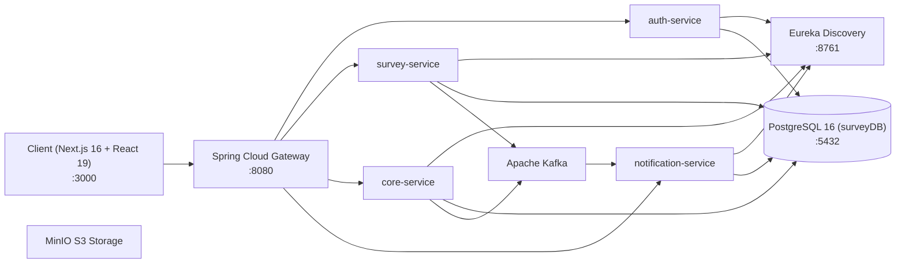

# ENTERPRISE SURVEY PLATFORM - AGENT ENTRYPOINT & SYSTEM CONTEXT

> **Phạm vi tài liệu:** Đây là file cổng chào (Router) cung cấp toàn bộ ngữ cảnh hệ thống, tiến độ tính năng, quy ước lập trình và danh mục tài liệu định tuyến cho Agent AI khi bắt đầu một phiên làm việc mới.

---

## 1. TỔNG QUAN HỆ THỐNG & CẤU TRÚC WORKSPACE

Hệ thống **Enterprise Survey Platform** là nền tảng thiết kế biểu mẫu động và phân tích thống kê đa chiều cấp doanh nghiệp với kiến trúc phân tán:



### Đường dẫn thư mục chính:
- **Backend Microservices:** `D:\code\java\springboot\BE_KhaoSat` (Java 17, Spring Boot 3.5.x, Maven multi-module).
  - `gateway-service`: Cổng API trung tâm (:8080), xử lý định tuyến & kiểm tra JWT token.
  - `survey-service`: Quản lý khảo sát, câu hỏi, trang, điều kiện rẽ nhánh, bảng ma trận, phân tích thống kê, dataset phẳng, lưu trữ mẫu báo cáo, đồng bộ Google Forms.
  - `auth-service`: Quản lý người dùng, vai trò, xác thực JWT & quyền hạn.
  - `core-service`: Quản trị cấu hình hệ thống, menu, thông báo nội bộ.
  - `notification-service`: Xử lý thông báo qua Email, Telegram Bot, Zalo.
- **Frontend Web Client:** `D:\code\react\khaosat\client` (Next.js 16 App Router, Turbopack, React 19, Tailwind CSS v4, Lucide React, ECharts 6, DnD Kit, ExcelJS). Port `:3000`.
- **Hạ tầng Docker:** PostgreSQL 16 (database `surveyDB` - chú ý chữ hoa `DB`), Kafka, MinIO, Nginx.

---

## 2. TIẾN ĐỘ TÍNH NĂNG ĐÃ TRIỂN KHAI HOÀN THIỆN

### A. Phân Hệ Báo Cáo Khảo Sát 4 Tab Độc Lập (`/admin/survey/[id]/result`)
1. **Tab 1 - Tổng quan (`SurveyDashboardTab.tsx`):**
   - KPI sinh mệnh: Lượt xem, lượt nộp, tỷ lệ hoàn thành, thời gian làm bài trung bình.
   - Biểu đồ Timeline lưu lượng bài nộp theo giờ & ngày.
2. **Tab 2 - Phân tích câu hỏi (`SummaryTab.tsx`):**
   - Thống kê chi tiết từng câu hỏi (Biểu đồ cột, vành khăn Donut, hoa hồng Rose, dải điểm ScoreRangeHistogram).
   - **Tự động sinh thẻ phân tích cho Cột tự tạo & Công thức Excel:** Khi người dùng tạo cột tính toán bằng công thức AST, hệ thống tự động sinh các card chuyên biệt (dạng Số: TB, Trung vị, Min, Max + Biểu đồ phân bổ + Drill-down; dạng Phân loại: Biểu đồ tỷ lệ đáp án).
3. **Tab 3 - Báo cáo tùy chỉnh (`CustomReportTab.tsx`):**
   - **Trang 1: Chỉ xem (`view`):** Báo cáo điều hành sạch sẽ, lưới responsive 12 cột (`half` = 2 khối/hàng, `full` = 1 khối/hàng), thẻ KPI, biểu đồ độc lập, bảng tổng hợp.
   - **Trang 2: Thiết lập (`setup` - Studio 2 vùng Master-Detail):**
     - Cột trái: Danh sách khối, đổi thứ tự Lên/Xuống, xóa, nhân bản (+ Biểu đồ, + Bảng, + Thẻ KPI).
     - Vùng phải: Cấu hình chi tiết khối (Tiêu đề, Bỏ qua bộ lọc chung, Gom nhóm 0..3 cấp, Chỉ số đo lường, Bộ lọc riêng cho từng khối qua `FilterBuilderBar`, Live Preview tức thì).
     - **Nút "Lưu mẫu báo cáo" trực tiếp:** Đặt ngay trên Header của phòng Thiết lập, cho phép bấm *Lưu thay đổi* (kèm chấm báo hiệu thay đổi chưa lưu) hoặc *Lưu bản sao / Lưu mẫu mới* thông qua `SaveViewModal` mà không cần thoát ra trang Xem.
     - **Lưu trữ đa thiết lập trong 1 khảo sát:** Tận dụng cột `definition_json` (JSONB) của bảng `report_views` ở backend (`reportKind: "custom_dashboard"`, `version: 2`).
4. **Tab 4 - Phản hồi (`ResponseListTab.tsx`):**
   - Danh sách bài nộp chi tiết phân trang, tìm kiếm và xem modal bài làm.

### B. Biểu Đồ Đường Xu Hướng Đa Nhóm (Multi-line Group Pivot) (`ResultChartView.tsx`)
- Tự động kích hoạt khi chọn dạng **Đường xu hướng (`line`)** và cấu hình **2 chiều Gom nhóm** (`output.pivotMatrix`):
  - **Trục hoành X:** Chiều gom nhóm 1 (ví dụ: mốc điểm từ 1 đến 10).
  - **Trục tung Y:** Số lượng phản hồi (`count` / Số phiếu N) hoặc giá trị đo lường (`avg`, `sum`).
  - **Các đường (Multi-line Series):** Từng nhóm thuộc Chiều gom nhóm 2 (ví dụ: Đường 1 là KHTN, Đường 2 là KHXH; hoặc từng Lớp, từng Khối).
  - Đường nét mượt mà (`smooth: true`), điểm tròn (`symbol: "circle"`, `symbolSize: 6`), nét dày `2.5px`, màu sắc tự động theo `ECHARTS_PALETTE`.
  - **Tooltip so sánh trục hoành:** Hover vào bất kỳ mốc điểm nào để so sánh đồng thời số liệu các nhóm.
  - **Drill-down chính xác:** Nhấp vào điểm dữ liệu trên đường để mở danh sách phản hồi khớp đúng với mốc điểm & nhóm (`cell.recordIds`).

### C. Cơ Chế Chuẩn Hóa Tên Câu Hỏi Khi Khảo Sát Có Nhiều Trang
- Hệ thống tự động gắn tiền tố `[Tên trang]` vào trước tên câu hỏi khi khảo sát có từ 2 trang trở lên (ví dụ: `[Điểm KHTN] Điểm trung bình` vs `[Tổ hợp khoa học xã hội] Điểm trung bình`).
- Loại bỏ hoàn toàn sự nhầm lẫn giữa các câu hỏi trùng tên ở các profile/trang khác nhau trong bộ lọc và bảng chọn.

### D. Xuất Báo Cáo Excel Đa Khối Chuẩn Doanh Nghiệp (`excel.ts`)
- Xuất file `.xlsx` 3 sheet chuẩn qua `exceljs`:
  1. `Tong_quan`: Thông tin khảo sát, điều kiện lọc chung, danh sách cột công thức.
  2. `Tong_hop_cac_khoi`: Xuất dữ liệu của toàn bộ các khối trong Báo cáo tùy chỉnh (giữ nguyên định dạng số và màu sắc highlight nhóm cao nhất / thấp nhất).
  3. `Du_lieu_chi_tiet`: Danh sách phản hồi chi tiết của các bài làm khớp bộ lọc.

---

## 3. DANH MỤC TÀI LIỆU ĐỌC THEO YÊU CẦU (READ-ON-DEMAND INDEX)

| Mục tiêu nghiệp vụ / Kỹ thuật | Tài liệu cần đọc trước | Đường dẫn tệp |
| :--- | :--- | :--- |
| Kiến trúc tổng thể, mô hình C4, luồng dữ liệu & quyết định thiết kế | **Master Architecture Blueprint** | [docs/ARCHITECTURE.md](file:///d:/code/java/springboot/BE_KhaoSat/docs/ARCHITECTURE.md) |
| Kiến trúc Frontend, Form Builder, ECharts, Báo cáo tùy chỉnh, AST Formula | **Frontend Architecture Manual** | [docs/frontend.md](file:///d:/code/java/springboot/BE_KhaoSat/docs/frontend.md) |
| Thiết kế Backend, Microservices, CSDL PostgreSQL, REST APIs | **Backend Architecture Manual** | [docs/backend.md](file:///d:/code/java/springboot/BE_KhaoSat/docs/backend.md) |
| Hướng dẫn triển khai Docker Compose, môi trường, biến cấu hình | **Deployment & Infrastructure Guide** | [docs/deployment.md](file:///d:/code/java/springboot/BE_KhaoSat/docs/deployment.md) |

---

## 4. QUY TẮC LẬP TRÌNH & NHỮNG ĐIỀU CẦN LƯU Ý (GOTCHAS)

1. **React State Updates (Pure Reducer Rule):**
   - **TUYỆT ĐỐI KHÔNG** gọi callback cập nhật state của component cha (như `onChangeDashboardDef`, `onDefinitionChange`) trực tiếp bên trong hàm updater của `setState((prev) => { ... })`. Điều này sẽ vi phạm quy tắc pure render của React 18/19 và gây lỗi runtime:
     `Cannot update a component while rendering a different component`.
   - **Luôn bọc lời gọi cha trong `queueMicrotask(() => { onChange(next); });`**.
2. **Triết lý Tối Giản (Ponytail / YAGNI):**
   - Ưu tiên giải pháp ngắn gọn, tối giản, trực tiếp.
   - Tái sử dụng các tiện ích, hàm format và type đã có trong repo (`@/lib/report-engine`, `@/types/report`). Không tạo thêm abstraction thừa.
3. **Đường dẫn tệp (File Links):**
   - Luôn sử dụng cú pháp markdown link click được với giao thức `file:///` và dấu gạch xuôi `/` (ví dụ: `[CustomReportTab.tsx](file:///D:/code/react/khaosat/client/src/components/result/report-builder/CustomReportTab.tsx)`).
4. **Cơ sở dữ liệu:**
   - Tên database PostgreSQL là `surveyDB` (chú ý chữ hoa `DB`).
   - Cổng kết nối nội bộ: `5432`, user: `postgres`, pass: `postgres`.
5. **Git Repositories:**
   - Cả 2 repo (Backend `BE_KhaoSat` và Frontend `client`) đều sử dụng nhánh chính là `main` đồng bộ với GitHub `origin/main`.

---

## 5. LỆNH KIỂM THỬ & XÁC THỰC NHANH (QUICK RUN COMMANDS)

### Frontend (`D:\code\react\khaosat\client`)
```powershell
# Chạy bộ Unit Tests cho Report Engine & Export (19 tests)
Set-Location "D:\code\react\khaosat\client"; npx vitest run

# Kiểm tra Linter cho các tệp đã sửa
Set-Location "D:\code\react\khaosat\client"; npx eslint src/components/result/report-builder/CustomReportTab.tsx src/components/result/report-builder/ResultChartView.tsx

# Kiểm tra biên dịch Production Next.js
Set-Location "D:\code\react\khaosat\client"; npm run build
```

### Backend (`D:\code\java\springboot\BE_KhaoSat`)
```powershell
# Kiểm tra trạng thái các container Docker
docker ps --format "table {{.Names}}\t{{.Status}}\t{{.Ports}}"

# Kiểm tra dữ liệu trong surveyDB
docker exec -i $(docker ps -q -f "name=postgres") psql -U postgres -d surveyDB -c "SELECT count(*) FROM surveys;"
```
