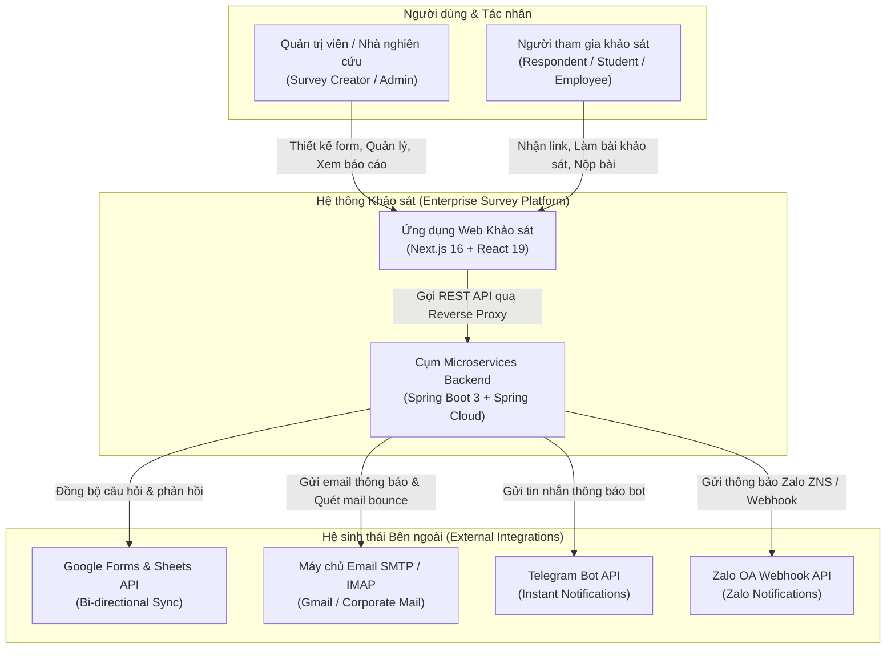
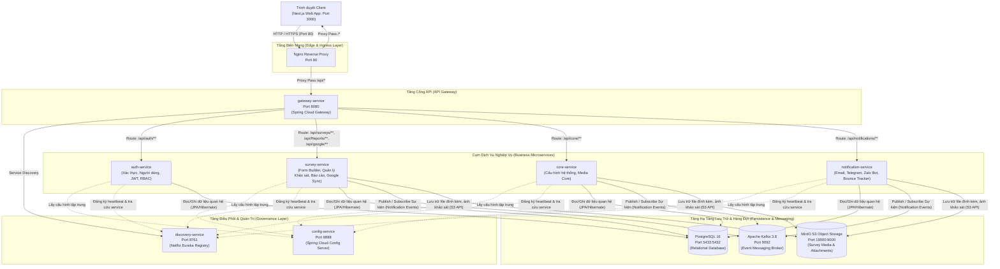
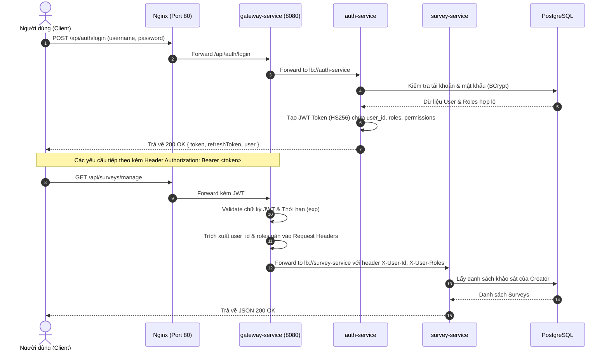
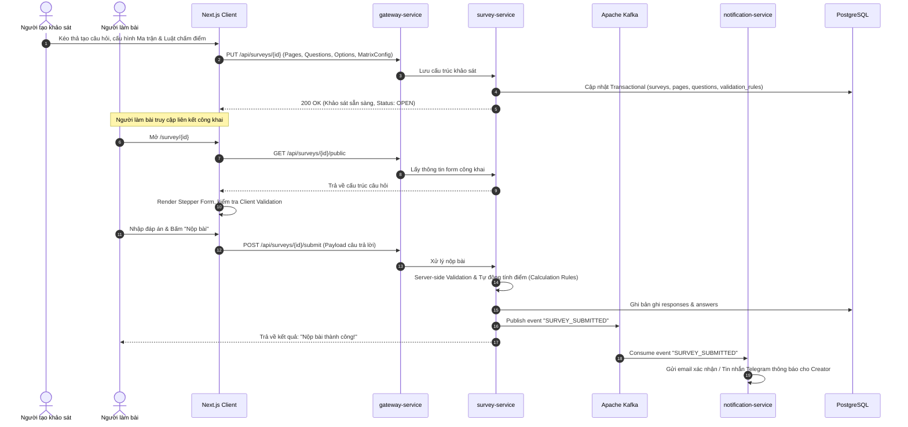
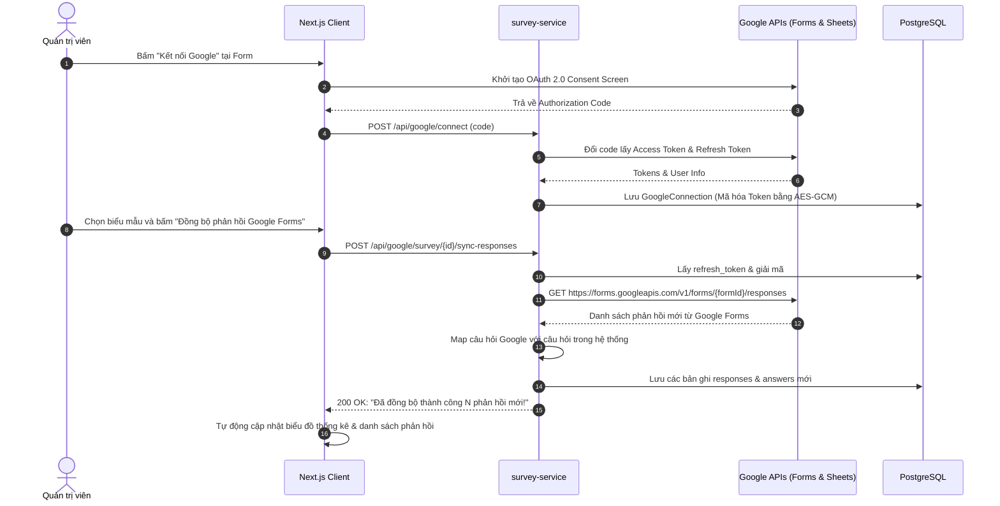
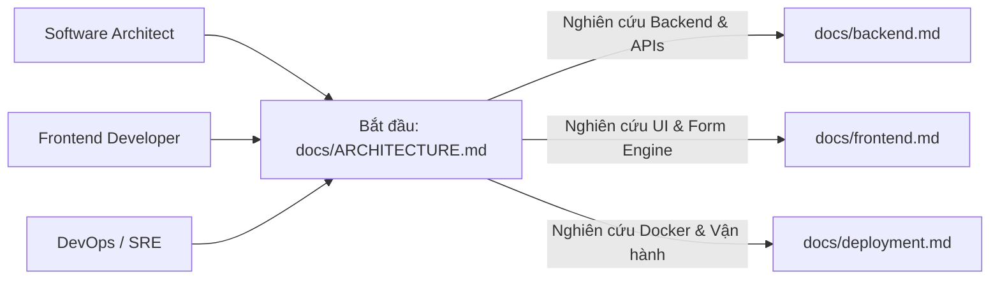

# HỆ THỐNG QUẢN LÝ & PHÂN TÍCH KHẢO SÁT DOANH NGHIỆP (ENTERPRISE SURVEY PLATFORM)
## TÀI LIỆU KIẾN TRÚC TỔNG THỂ (MASTER ARCHITECTURE BLUEPRINT)

> **Phiên bản:** 2.0.0  
> **Trạng thái:** Hoạt động (Production Ready)  
> **Đối tượng độc giả:** Software Architects, Lead Developers, DevOps Engineers, System Administrators  
> **Ngôn ngữ triển khai:** Java 17 / Spring Boot 3.5.x (Backend), TypeScript / Next.js 16 (Frontend)  
> **Hạ tầng:** Docker Compose, PostgreSQL 16, Apache Kafka, MinIO S3, Nginx  

---

## MỤC LỤC KIẾN TRÚC
1. [TỔNG QUAN HỆ THỐNG (EXECUTIVE SUMMARY)](#1-tổng-quan-hệ-thống-executive-summary)
2. [MÔ HÌNH KIẾN TRÚC C4 (C4 ARCHITECTURE MODEL)](#2-mô-hình-kiến-trúc-c4-c4-architecture-model)
   - [2.1. C4 Context Diagram (Bối cảnh Hệ thống)](#21-c4-context-diagram-bối-cảnh-hệ-thống)
   - [2.2. C4 Container Diagram (Các Khối Vận Hành)](#22-c4-container-diagram-các-khối-vận-hành)
3. [CÁC QUYẾT ĐỊNH THIẾT KẾ CỐT LÕI (ARCHITECTURAL DECISIONS & RATIONALE)](#3-các-quyết-định-thiết-kế-cốt-lõi-architectural-decisions--rationale)
4. [LUỒNG DỮ LIỆU ĐẶC TRƯNG (END-TO-END DATA FLOWS & SEQUENCE DIAGRAMS)](#4-luồng-dữ-liệu-đặc-trưng-end-to-end-data-flows--sequence-diagrams)
   - [4.1. Luồng Xác thực & Phân quyền qua API Gateway](#41-luồng-xác-thực--phân-quyền-qua-api-gateway)
   - [4.2. Luồng Vòng đời Khảo sát: Thiết kế, Điền bài & Chấm điểm](#42-luồng-vòng-đời-khảo-sát-thiết-kế-điền-bài--chấm-điểm)
   - [4.3. Luồng Đồng bộ Hai chiều với Google Forms & Google Sheets](#43-luồng-đồng-bộ-hai-chiều-với-google-forms--google-sheets)
5. [MÔ HÌNH BẢO MẬT HỆ THỐNG (SECURITY ARCHITECTURE)](#5-mô-hình-bảo-mật-hệ-thống-security-architecture)
6. [HỆ THỐNG GIAO TIẾP SỰ KIỆN (EVENT-DRIVEN WITH KAFKA)](#6-hệ-thống-giao-tiếp-sự-kiện-event-driven-with-kafka)
7. [HỆ THỐNG LƯU TRỮ TỆP TIN (MINIO S3 STORAGE)](#7-hệ-thống-lưu-trữ-tệp-tin-minio-s3-storage)
8. [ĐƯỜNG DẪN ĐỌC TÀI LIỆU THEO VAI TRÒ (READING PATHS)](#8-đường-dẫn-đọc-tài-liệu-theo-vai-trò-reading-paths)

---

## 1. TỔNG QUAN HỆ THỐNG (EXECUTIVE SUMMARY)

Hệ thống **Enterprise Survey Platform** là một nền tảng thu thập dữ liệu, thiết kế biểu mẫu động và phân tích thống kê đa chiều cấp doanh nghiệp. Nền tảng được xây dựng dựa trên kiến trúc **Microservices phân tán** (Distributed Microservices Architecture) với Spring Cloud ở tầng Backend kết hợp ứng dụng Web hiện đại chạy **Next.js 16 App Router (React 19)** ở tầng Frontend.

### Điểm khác biệt và Giá trị kỹ thuật cốt lõi:
1. **Trình thiết kế biểu mẫu cấp cao (Advanced Form Builder Engine):** Lấy cảm hứng từ Figma với Floating Dock, hỗ trợ hơn 16 loại câu hỏi phức tạp: từ văn bản, trắc nghiệm đơn/nhiều lựa chọn đến các dạng câu hỏi chuyên sâu như **Bảng ma trận đơn (Matrix Single)**, **Bảng ma trận chọn nhiều (Matrix Multi)**, **Ma trận nhập liệu (Matrix Input)** và **Bảng nhập liệu động (Dynamic Table)**.
2. **Hệ thống Luật ràng buộc & Vai trò tính toán (Validation & Calculation Engine):** Tự động kiểm tra biểu thức chính quy (Regex), phạm vi số, số điện thoại, email; hỗ trợ thiết lập vai trò tính toán (tự động cộng dồn, tính trung bình từ các tiêu chí con lên tiêu chí cha).
3. **Đồng bộ hóa 2 chiều với Google Workspace:** Tích hợp trực tiếp Google Forms API và Google Sheets API với cơ chế mã hóa khóa bảo mật, cho phép nhập biểu mẫu từ Google, phát hành lên Google Forms và tự động kéo phản hồi về hệ sinh thái nội bộ.
4. **Phân tích Báo cáo Đa chiều, Báo Cáo Tùy Chỉnh Đa Khối & Drill-Down:** Thống kê phân bố tần suất, dải điểm (Score Range Histogram), Gom nhóm thông minh (Smart Grouping), Báo cáo tùy chỉnh đa khối (Studio 2 vùng, thẻ KPI, bảng tổng hợp, biểu đồ đường xu hướng đa nhóm Multi-line Group Pivot, lưu nhiều mẫu báo cáo độc lập trong 1 khảo sát, xuất Excel đa khối) và Drawer trượt xem chi tiết từng bài làm ngay tại chỗ.
5. **Hạ tầng Đóng gói Toàn diện (Full-stack Containerization):** Toàn bộ 11 container vi dịch vụ và phụ trợ (Spring Cloud, PostgreSQL, Apache Kafka, MinIO S3, Nginx) được định nghĩa chặt chẽ qua Docker Compose, sẵn sàng vận hành cục bộ hoặc mở rộng trên Kubernetes.

---

## 2. MÔ HÌNH KIẾN TRÚC C4 (C4 ARCHITECTURE MODEL)

### 2.1. C4 Context Diagram (Bối cảnh Hệ thống)

Sơ đồ mô tả ranh giới hệ thống, các đối tượng tương tác chính (Người dùng, Quản trị viên, Khảo sát viên) và các hệ thống bên ngoài liên kết:



---

### 2.2. C4 Container Diagram (Các Khối Vận Hành)

Sơ đồ thể hiện cụm các container dịch vụ độc lập, cổng mạng, cơ chế giao tiếp nội bộ và kho lưu trữ dữ liệu:



---

## 3. CÁC QUYẾT ĐỊNH THIẾT KẾ CỐT LÕI (ARCHITECTURAL DECISIONS & RATIONALE)

### Quyết định 1: Kiến trúc Microservices phân chia theo miền nghiệp vụ (Domain-Driven Microservices)
- **Bối cảnh:** Hệ thống cần xử lý đồng thời hai luồng tải rất khác nhau: luồng nộp bài khảo sát với lưu lượng cao (High Throughput Write) trong các đợt cao điểm và luồng thiết kế/phân tích báo cáo phức tạp với tính toán số liệu lớn (Heavy Analytical Read).
- **Lựa chọn:** Tách thành `auth-service`, `survey-service`, `core-service`, `notification-service`.
- **Lý do:**
  - `survey-service` có thể co giãn độc lập (Scale horizontally) khi lượng người nộp bài tăng vọt.
  - Sự cố tại kênh gửi thông báo (Email/Zalo/Telegram) trong `notification-service` hoàn toàn không ảnh hưởng đến khả năng nộp bài khảo sát của người dùng.
  - Quản lý phụ thuộc cô lập: `survey-service` tích hợp Google API và Apache POI không làm phình to mã nguồn của `auth-service`.

### Quyết định 2: Tách biệt Discovery Server (Eureka) và Central Config (Spring Cloud Config)
- **Bối cảnh:** 5 microservices backend chạy đồng thời với nhiều biến môi trường, thông tin kết nối DB và credentials.
- **Lựa chọn:** Triển khai `config-service` đọc từ `config-repo/` kết hợp `discovery-service` (Eureka).
- **Lý do:**
  - Định tuyến linh hoạt: `gateway-service` không cần hardcode địa chỉ IP hay port của các microservice con, hoàn toàn định tuyến qua tên dịch vụ Eureka (`lb://survey-service`, `lb://auth-service`).
  - Thay đổi cấu hình không cần build lại Docker image: Chỉ cần cập nhật file YAML trong `config-repo` và kích hoạt refresh.

### Quyết định 3: Stateless Authentication với JWT tại API Gateway
- **Bối cảnh:** Hệ thống cần hỗ trợ cả người dùng có tài khoản quản trị (Admin/Creator) và người làm bài khảo sát ẩn danh hoặc xác thực qua link phân quyền.
- **Lựa chọn:** Sử dụng JWT Token ký bảo mật bằng thuật toán HMAC-SHA256 (`KeyNayPhaiDaiHon32KyTuDeBaoMat123456`).
- **Lý do:**
  - API Gateway giải mã và xác thực chữ ký token một lần duy nhất tại cửa ngõ.
  - Gateway trích xuất thông tin người dùng (`X-User-Id`, `X-User-Roles`, `X-User-Permissions`) và chuyển tiếp qua HTTP Headers xuống các service bên dưới. Các microservice bên trong không cần truy vấn lại cơ sở dữ liệu để kiểm tra quyền, tối ưu hóa tối đa độ trễ.

### Quyết định 4: Event-Driven Architecture với Apache Kafka cho Thông báo
- **Bối cảnh:** Khi có phản hồi khảo sát mới hoặc khi gửi khảo sát hàng loạt, hệ thống cần gửi email, tin nhắn Telegram hoặc Zalo cho hàng trăm/hàng nghìn người. Nếu gửi đồng bộ (Synchronous HTTP) sẽ làm treo luồng nộp bài và gây lỗi Timeout.
- **Lựa chọn:** Đưa các sự kiện gửi thông báo vào Topic Kafka (`notification-events`).
- **Lý do:**
  - `survey-service` ghi nhận bài làm thành công và đẩy message vào Kafka trong vài mili-giây, trả kết quả tức thì cho người làm bài.
  - `notification-service` tiêu thụ message (Consumer), tự động retry khi gặp lỗi mạng, và xử lý email bounce ngầm mà không làm ảnh hưởng luồng chính.

### Quyết định 5: Hệ thống Biểu mẫu lai (Hybrid Relational + JSON Data Model)
- **Bối cảnh:** Câu hỏi khảo sát có thể rất đơn giản (chọn 1 đáp án), nhưng cũng có thể là ma trận nhiều chiều (Matrix) hoặc bảng động (Dynamic Table) với số cột/hàng thay đổi liên tục. Nếu chuẩn hóa 100% quan hệ (Normalized RDBMS) sẽ cần hàng chục bảng trung gian và câu lệnh JOIN cực kỳ phức tạp.
- **Lựa chọn:** Thiết kế mô hình lai: Các thực thể chính (`Survey`, `Page`, `Question`, `Option`, `Response`) lưu trữ dưới dạng bảng quan hệ chuẩn; các cấu trúc linh hoạt như cấu hình ma trận (`matrixConfig`) và kết quả ma trận (`matrixData`) được lưu trữ dạng JSON có cấu trúc trong cột văn bản/JSON của bảng `answers`.
- **Lý do:** Đảm bảo toàn vẹn dữ liệu ngoại khóa nhưng vẫn duy trì tính linh hoạt tối đa khi thêm các loại câu hỏi mới.

---

## 4. LUỒNG DỮ LIỆU ĐẶC TRƯNG (END-TO-END DATA FLOWS & SEQUENCE DIAGRAMS)

### 4.1. Luồng Xác thực & Phân quyền qua API Gateway



---

### 4.2. Luồng Vòng đời Khảo sát: Thiết kế, Điền bài & Chấm điểm



---

### 4.3. Luồng Đồng bộ Hai chiều với Google Forms & Google Sheets

Hệ thống hỗ trợ kết nối tài khoản Google OAuth 2.0, trích xuất biểu mẫu từ Google Forms và tự động kéo các phản hồi mới về cơ sở dữ liệu nội bộ:



---

## 5. MÔ HÌNH BẢO MẬT HỆ THỐNG (SECURITY ARCHITECTURE)

Hệ thống triển khai mô hình bảo mật đa tầng (Defense in Depth) từ tầng mạng đến tầng dữ liệu:

| Tầng bảo vệ | Cơ chế thực thi | Chi tiết kỹ thuật |
| :--- | :--- | :--- |
| **Biên mạng (Ingress)** | Nginx Reverse Proxy | Giới hạn dung lượng upload (`client_max_body_size 50M`), ẩn header phiên bản server, chặn truy cập trực tiếp các port backend nội bộ. |
| **Cổng API (Gateway)** | Spring Cloud Gateway | Kiểm tra tính hợp lệ của JWT, chặn các đường dẫn admin nếu không có role tương ứng, cấu hình CORS nghiêm ngặt (`allowedOrigins: http://localhost:3000`). |
| **Dịch vụ nội bộ** | Spring Security 6 | Chế độ `SessionCreationPolicy.STATELESS`. Sử dụng Filter nội bộ đọc danh tính từ Header Gateway (`X-User-Id`, `X-User-Roles`). |
| **Bảo vệ dữ liệu nhạy cảm** | Mã hóa Token Google OAuth | Refresh Token và Client Secret của Google được mã hóa hai chiều bằng thuật toán `AES-256-GCM` với khóa bảo mật môi trường (`GOOGLE_ENCRYPTION_SECRET`). |
| **Mật khẩu người dùng** | Password Encoder | Mã hóa bằng thuật toán `BCrypt` với độ dài Salt chuẩn (Strength 10). |
| **Kiểm soát truy cập khảo sát** | Survey Access Guard | Kiểm tra quyền tác giả (Creator Check), quyền chia sẻ qua email/tổ chức trước khi cho phép chỉnh sửa hoặc xem báo cáo mật. |

---

## 6. HỆ THỐNG GIAO TIẾP SỰ KIỆN (EVENT-DRIVEN WITH KAFKA)

Hệ thống sử dụng **Apache Kafka 3.8** làm trục truyền tin (Event Bus) cho các tác vụ bất đồng bộ:

```
[survey-service] ---> TOPIC: notification-events ---> [notification-service]
       |                                                       |
  (Event Producer)                                       (Event Consumer)
  - Submission Event                                     - Gửi Email xác nhận (JavaMail)
  - Survey Invited Event                                 - Gửi Telegram Bot Message
  - Reminder Event                                       - Gửi Zalo Webhook
                                                         - Quét hòm thư IMAP xử lý Bounce
```

- **Tính tin cậy (Reliability):** Cơ chế Acknowledgment (`acks=all`), phân vùng Topic đảm bảo thứ tự gửi thông báo theo khảo sát, và chính sách Exponential Backoff Retry (thử lại sau 1 phút, 5 phút).
- **Dead Letter Queue (DLQ):** Khi gửi email thất bại vượt quá số lần cấu hình (`NOTIFICATION_MAX_ATTEMPTS=3`), message được chuyển vào DLQ để theo dõi và xử lý sau.

---

## 7. HỆ THỐNG LƯU TRỮ TỆP TIN (MINIO S3 STORAGE)

Tất cả các tệp nhị phân và đối tượng phi cấu trúc được quản lý tập trung trên **MinIO Object Storage** tương thích 100% giao thức Amazon S3:

- **Bucket `survey-media`:** Lưu trữ ảnh banner khảo sát, ảnh minh họa câu hỏi, logo tổ chức, chữ ký số của người làm bài (`SIGNATURE`).
- **Bucket `notification-attachments`:** Lưu trữ các file tài liệu đính kèm gửi kèm theo email thông báo khảo sát.
- **Quy trình Upload an toàn:** Hỗ trợ cơ chế Presigned URL hoặc Upload trực tiếp qua dịch vụ backend có kiểm tra MIME type (chặn thực thi các file độc hại như `.exe`, `.sh`, `.php`).

---

## 8. ĐƯỜNG DẪN ĐỌC TÀI LIỆU THEO VAI TRÒ (READING PATHS)

Tùy theo mục đích công việc, đội ngũ kỹ thuật có thể tiếp cận tài liệu chuyên sâu theo các đường dẫn sau:



1. **Dành cho Backend Developer & Software Architect:**
   - Tiếp tục đọc [`docs/backend.md`](file:///d:/code/java/springboot/BE_KhaoSat/docs/backend.md) để nắm chi tiết về cấu trúc JPA Entity, luồng xử lý của `ReportService`, `ExcelExportService`, `StatisticsService`, các quy tắc tính toán điểm và danh mục REST API.
2. **Dành cho Frontend Developer & UX Designer:**
   - Tiếp tục đọc [`docs/frontend.md`](file:///d:/code/java/springboot/BE_KhaoSat/docs/frontend.md) để tìm hiểu sâu về kiến trúc Component, Figma Floating Dock, cơ chế kéo thả DnD Kit, bộ vẽ biểu đồ ECharts và Drawer Drill-Down.
3. **Dành cho DevOps & Kỹ sư Vận hành hệ thống:**
   - Tiếp tục đọc [`docs/deployment.md`](file:///d:/code/java/springboot/BE_KhaoSat/docs/deployment.md) để xem chi tiết cấu hình `docker-compose.yml`, các biến môi trường bắt buộc, cấu hình Nginx, và quy trình bảo trì/sao lưu PostgreSQL.

