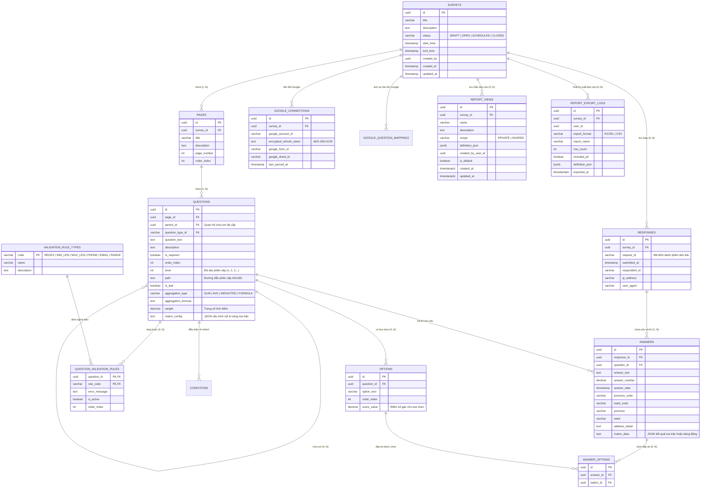

# KIẾN TRÚC CHUYÊN SÂU BACKEND MICROSERVICES & TÀI LIỆU API
## (BACKEND ARCHITECTURE MANUAL & REST API SPECIFICATIONS)

> **Dự án:** Enterprise Survey Platform - Backend Microservices  
> **Ngôn ngữ:** Java 17 (OpenJDK 17 LTS)  
> **Framework chính:** Spring Boot 3.5.6, Spring Cloud 2024.x, Hibernate ORM 6.6  
> **Cơ sở dữ liệu:** PostgreSQL 16  
> **Hàng đợi thông điệp:** Apache Kafka 3.8  
> **Lưu trữ đối tượng:** MinIO S3 Object Storage  
> **Thư viện văn phòng:** Apache POI 5.x (Excel processing)  

---

## MỤC LỤC
1. [BẢNG TỔNG HỢP DANH MỤC MICROSERVICES](#1-bảng-tổng-hợp-danh-mục-microservices)
2. [CHI TIẾT KIẾN TRÚC TỪNG MICROSERVICE](#2-chi-tiết-kiến-trúc-từng-microservice)
   - [2.1. gateway-service (Cổng điều phối & Bảo vệ)](#21-gateway-service-cổng-điều-phối--bảo-vệ)
   - [2.2. discovery-service (Netflix Eureka Registry)](#22-discovery-service-netflix-eureka-registry)
   - [2.3. config-service (Spring Cloud Config Server)](#23-config-service-spring-cloud-config-server)
   - [2.4. auth-service (Xác thực & Quản lý Danh tính)](#24-auth-service-xác-thực--quản-lý-danh-tính)
   - [2.5. core-service (Quản trị Người dùng, Phân quyền & Menu)](#25-core-service-quản-trị-người-dùng-phân-quyền--menu)
   - [2.6. survey-service (Trọng tâm: Biểu mẫu, Dữ liệu & Phân tích)](#26-survey-service-trọng-tâm-biểu-mẫu-dữ-liệu--phân-tích)
   - [2.7. notification-service (Xử lý Thông báo Đa kênh & Bounce Mail)](#27-notification-service-xử-lý-thông-báo-đa-kênh--bounce-mail)
3. [MÔ HÌNH DỮ LIỆU & SƠ ĐỒ THỰC THỂ (DATABASE ERD)](#3-mô-hình-dữ-liệu--sơ-đồ-thực-thể-database-erd)
4. [CÁC ĐỘNG CƠ XỬ LÝ NGHIỆP VỤ ĐẶC TRÙ](#4-các-động-cơ-xử-lý-nghiệp-vụ-đặc-trù)
   - [4.1. Động cơ Câu hỏi Ma trận & Bảng nhập liệu động (Matrix & Dynamic Table)](#41-động-cơ-câu-hỏi-ma-trận--bảng-nhập-liệu-động-matrix--dynamic-table)
   - [4.2. Động cơ Tiêu chí Đa cấp Cha-Con & Tổng hợp Số liệu (Hierarchical Aggregation)](#42-động-cơ-tiêu-chí-đa-cấp-cha-con--tổng-hợp-số-liệu-hierarchical-aggregation)
   - [4.3. Động cơ Kiểm tra Ràng buộc (Question Validation Rules Engine)](#43-động-cơ-kiểm-tra-ràng-buộc-question-validation-rules-engine)
   - [4.4. Động cơ Đồng bộ Google Forms & Google Sheets](#44-động-cơ-đồng-bộ-google-forms--google-sheets)
   - [4.5. Động cơ Xuất Excel Đa Ma trận (Apache POI Excel Export)](#45-động-cơ-xuất-excel-đa-ma-trận-apache-poi-excel-export)
5. [TỔNG HỢP DANH MỤC REST API CHÍNH (API SPECIFICATION)](#5-tổng-hợp-danh-mục-rest-api-chính-api-specification)

---

## 1. BẢNG TỔNG HỢP DANH MỤC MICROSERVICES

| Tên Dịch Vụ | Module Thư Mục | Cổng Nội Bộ | Cổng Công Khai | Vai Trò Kỹ Thuật |
| :--- | :--- | :--- | :--- | :--- |
| **`discovery-service`** | `./discovery-service` | `8761` | `8761` (Host) | Service Discovery & Registry sử dụng Netflix Eureka. Theo dõi Heartbeat sức khỏe của toàn bộ microservices. |
| **`config-service`** | `./config-service` | `8888` | `8888` (Host) | Quản lý cấu hình tập trung từ `./config-repo`, cấp phát profile theo môi trường (dev, prod). |
| **`gateway-service`** | `./gateway-service` | `8080` | `127.0.0.1:8080` | API Gateway cửa ngõ. Tiếp nhận tất cả HTTP traffic, rate limiting, kiểm tra JWT, strip prefix `/api` và forward. |
| **`auth-service`** | `./auth-service` | `8080` | Không mở | Xác thực đăng nhập, đăng ký, cấp phát và làm mới JWT token. |
| **`core-service`** | `./core-service` | `8080` | Không mở | Quản lý người dùng, vai trò (Role), quyền hạn (Permission), cây menu phân quyền, bắn event Kafka. |
| **`survey-service`** | `./survey-service` | `8082` | Không mở | Trái tim nghiệp vụ: Quản lý biểu mẫu, câu hỏi, quy tắc ràng buộc, ma trận, nộp bài, đồng bộ Google, xuất Excel và phân tích thống kê. |
| **`notification-service`** | `./notification-service`| `8080` | Không mở | Lắng nghe Kafka Topic `notification-events`, gửi email qua JavaMail, quét bounce qua IMAP, gửi Telegram & Zalo Webhook. |

---

## 2. CHI TIẾT KIẾN TRÚC TỪNG MICROSERVICE

### 2.1. gateway-service (Cổng điều phối & Bảo vệ)
- **Tập tin chính:**
  - `GatewayServiceApplication.java`: Khởi động Spring Cloud Gateway trên nền tảng Netty phản ứng (Reactive WebFlux).
  - `CorsConfig.java`: Cấu hình cho phép các phương thức `GET`, `POST`, `PUT`, `DELETE`, `PATCH`, `OPTIONS` từ origin `http://localhost:3000`.
  - `RateLimitFilter.java`: Chống tấn công brute-force / DoS bằng thuật toán Token Bucket.
  - `RequestLoggingFilter.java`: Ghi log toàn bộ thời gian xử lý và mã trạng thái của mỗi request.
- **Quy tắc định tuyến (Routing Rules):**
  - `/api/auth/**` $\rightarrow$ `lb://auth-service`
  - `/api/core/**` $\rightarrow$ `lb://core-service`
  - `/api/surveys/**`, `/api/Reports/**`, `/api/google/**` $\rightarrow$ `lb://survey-service`
  - `/api/notifications/**` $\rightarrow$ `lb://notification-service`

### 2.2. discovery-service (Netflix Eureka Registry)
- Cung cấp trang quản trị web tại `http://localhost:8761`.
- Quản lý metadata của từng instance: địa chỉ IP, trạng thái `UP`/`DOWN`, lease renewal interval (30s).

### 2.3. config-service (Spring Cloud Config Server)
- Tải cấu hình từ thư mục mount Docker `/config-repo/`.
- Hỗ trợ mã hóa bí mật (Symmetric key encryption) cho các mật khẩu kết nối database và token.

### 2.4. auth-service (Xác thực & Quản lý Danh tính)
- **Công nghệ bảo mật:** Spring Security 6 kết hợp JWT (`io.jsonwebtoken.jjwt-api:0.12.6`).
- **Mã hóa:** `BCryptPasswordEncoder` băm mật khẩu người dùng trước khi lưu vào bảng `users`.
- **Cấu trúc JWT Payload:**
  ```json
  {
    "iss": "myapp",
    "aud": "myapp",
    "id": "04f895c0-15ff-4c0e-ac76-da2cb0f9f25d",
    "sub": "admin",
    "roles": ["ROLE_ADMIN", "ADMIN"],
    "permissions": ["ALL"],
    "iat": 1794290000,
    "exp": 1794326000
  }
  ```

### 2.5. core-service (Quản trị Người dùng, Phân quyền & Menu)
- **Quản lý Cây Menu phân quyền:** Entity `Menu.java` theo cấu trúc cây cha-con (`parentId`, `orderIndex`, `path`, `icon`).
- **Phân quyền đa tầng (RBAC):** Bảng quan hệ N-N giữa `roles`, `permissions`, `functions` và `users`.
- **Kafka Producer:** Gửi sự kiện tạo tài khoản hoặc đổi mật khẩu vào topic Kafka thông qua `NotificationProducer.java`.

### 2.6. survey-service (Trọng tâm: Biểu mẫu, Dữ liệu & Phân tích)
Microservice cốt lõi chứa toàn bộ logic xử lý khảo sát:
- **`SurveyService.java`:** Quản lý vòng đời khảo sát: tạo mới, nhân bản, sửa đổi, cập nhật trạng thái (`DRAFT` $\rightarrow$ `SCHEDULED` $\rightarrow$ `OPEN` $\rightarrow$ `CLOSED`).
- **`QuestionService.java` & `PageService.java`:** Quản lý cấu trúc trang biểu mẫu và thứ tự các câu hỏi.
- **`ResponseService.java` & `PublicSurveyService.java`:** Xử lý người làm bài truy cập khảo sát công khai, kiểm tra điều kiện truy cập, lưu trữ câu trả lời, đảm bảo tính toàn vẹn Transaction (`@Transactional`).
- **`AnswerValidationService.java`:** Kiểm tra tính hợp lệ của câu trả lời tại tầng server theo các quy tắc `question_validation_rules` trước khi ghi vào database.
- **`AggregationEngineService.java`:** Xử lý tính toán tổng hợp số liệu từ câu hỏi con lên câu hỏi cha theo công thức trọng số (`weight`) hoặc công thức tự định nghĩa (`aggregationFormula`).
- **`ReportService.java` & `StatisticsService.java`:**
  - Tổng hợp số liệu thống kê: Đếm tần suất trắc nghiệm, tính trung bình, trung vị, min, max cho câu hỏi số học.
  - Cung cấp API `GET /api/Reports/survey/{surveyId}/dataset` trả về tập dữ liệu ma trận phẳng đầy đủ cho frontend.
  - Xuất báo cáo Excel phân tích (`responses.xlsx` và `analysis.xlsx`) qua Apache POI.
- **`GoogleSurveyService.java` & `GoogleResponseSyncService.java`:** Tích hợp trực tiếp Google Forms & Sheets API.

### 2.7. notification-service (Xử lý Thông báo Đa kênh & Bounce Mail)
- **`NotificationConsumer.java`:** Đọc sự kiện từ topic `notification-events`.
- **`EmailService.java`:** Gửi email HTML với template định sẵn qua JavaMailSender.
- **`EmailBounceMonitor.java`:** Lắng nghe hòm thư IMAP định kỳ qua cổng `993` SSL (`NOTIFICATION_BOUNCE_HOST: imap.gmail.com`), tự động phát hiện các email gửi lỗi (Hard bounce/Soft bounce) để đánh dấu địa chỉ hỏng, tránh làm giảm uy tín của tên miền gửi thư.
- **`TelegramService.java` & `ZaloService.java`:** Gửi tin nhắn qua Webhook bot.

---

## 3. MÔ HÌNH DỮ LIỆU & SƠ ĐỒ THỰC THỂ (DATABASE ERD)

Dưới đây là sơ đồ thực thể chi tiết của phân hệ Khảo sát (`survey-service`):



---

## 4. CÁC ĐỘNG CƠ XỬ LÝ NGHIỆP VỤ ĐẶC TRÙ

### 4.1. Động cơ Câu hỏi Ma trận & Bảng nhập liệu động (Matrix & Dynamic Table)
Hệ thống hỗ trợ 4 phân loại câu hỏi dạng bảng phức tạp:
1. **`MATRIX_SINGLE` (Ma trận chọn 1 lựa chọn mỗi hàng):** Ví dụ: Đánh giá chất lượng dịch vụ trên thang điểm từ Rất kém $\rightarrow$ Rất tốt.
2. **`MATRIX_MULTI` (Ma trận chọn nhiều lựa chọn mỗi hàng):** Cho phép người dùng đánh dấu nhiều checkbox trên cùng một hàng.
3. **`MATRIX_INPUT` (Ma trận nhập số hoặc chữ vào từng ô):** Người dùng nhập số liệu trực tiếp vào lưới hàng $\times$ cột.
4. **`DYNAMIC_TABLE` (Bảng nhập liệu động thêm/xóa hàng tùy ý):** Người làm bài có thể bấm `+ Thêm hàng` để nhập danh sách không giới hạn (ví dụ: Danh sách thành viên gia đình, danh sách công việc đã làm).

#### Cấu trúc lưu trữ JSON của `matrix_config`:
```json
{
  "rows": [
    { "id": "r1", "text": "Kỹ năng giao tiếp" },
    { "id": "r2", "text": "Kỹ năng chuyên môn" },
    { "id": "r3", "text": "Tinh thần đồng đội" }
  ],
  "columns": [
    { "id": "c1", "text": "Kém", "value": 1 },
    { "id": "c2", "text": "Trung bình", "value": 2 },
    { "id": "c3", "text": "Tốt", "value": 3 },
    { "id": "c4", "text": "Xuất sắc", "value": 4 }
  ]
}
```

#### Cấu trúc lưu trữ JSON của `matrix_data` trong bảng `answers`:
- Với `MATRIX_SINGLE`: `{"r1": "c3", "r2": "c4", "r3": "c3"}`
- Với `MATRIX_MULTI`: `{"r1": ["c1", "c3"], "r2": ["c2"]}`
- With `DYNAMIC_TABLE`:
  ```json
  [
    { "ho_ten": "Nguyễn Văn A", "nam_sinh": 1990, "quan_he": "Cha" },
    { "ho_ten": "Trần Thị B", "nam_sinh": 1993, "quan_he": "Mẹ" }
  ]
  ```

---

### 4.2. Động cơ Tiêu chí Đa cấp Cha-Con & Tổng hợp Số liệu (Hierarchical Aggregation)
Hệ thống hỗ trợ cấu trúc tiêu chí cây nhiều cấp:
- Mỗi câu hỏi có thể có `parentId` trỏ đến câu hỏi cha.
- Thuộc tính `level` xác định độ sâu (Cấp 1: Tiêu chuẩn lớn $\rightarrow$ Cấp 2: Tiêu chí $\rightarrow$ Cấp 3: Chỉ số đo lường chi tiết).
- Cơ chế tổng hợp (`aggregation_type`):
  - **`SUM`**: Điểm tiêu chí cha bằng tổng điểm các tiêu chí con.
  - **`AVG`**: Điểm tiêu chí cha bằng trung bình cộng các con.
  - **`WEIGHTED`**: Tính theo trọng số: $\text{Điểm cha} = \frac{\sum (\text{Điểm con}_i \times \text{weight}_i)}{\sum \text{weight}_i}$.
  - **`FORMULA`**: Điểm tính theo công thức biểu thức toán học tự do định nghĩa trong `aggregation_formula`.

Động cơ `AggregationEngineService.java` tự động duyệt cây từ nút lá (`is_leaf = true`) ngược lên nút gốc khi người dùng nộp bài, đảm bảo số liệu tổng hợp được tính toán chính xác và nhất quán.

---

### 4.3. Động cơ Kiểm tra Ràng buộc (Question Validation Rules Engine)
Hệ thống cho phép gán nhiều điều kiện kiểm tra đồng thời cho một câu hỏi:
- `AnswerValidationService.java` tiếp nhận câu trả lời và đối chiếu với danh sách luật trong `question_validation_rules`:
  - **`REGEX`**: Kiểm tra mẫu chuỗi ký tự theo biểu thức chính quy.
  - **`MIN_LENGTH` / `MAX_LENGTH`**: Giới hạn số ký tự tối thiểu / tối đa.
  - **`MIN_VALUE` / `MAX_VALUE`**: Giới hạn giá trị số học.
  - **`PHONE_VN`**: Kiểm tra định dạng số điện thoại Việt Nam (10 chữ số, đầu số hợp lệ).
  - **`EMAIL`**: Kiểm tra định dạng email chuẩn RFC 5322.
  - **`NUMERIC`**: Bắt buộc chỉ chứa chữ số.
- Nếu không thỏa mãn, ném ngoại lệ `ValidationException` kèm thông điệp lỗi tùy chỉnh (`errorMessage`) để hiển thị trực tiếp cho người làm bài.

---

### 4.4. Động cơ Đồng bộ Google Forms & Google Sheets
- **`GoogleOAuthService.java`:** Quản lý vòng đời OAuth 2.0 (Authorization Code $\rightarrow$ Access Token / Refresh Token).
- **Mã hóa Token hai chiều:** Sử dụng thuật toán chuẩn `AES-256-GCM` với khóa `GOOGLE_ENCRYPTION_SECRET`:
  ```java
  Cipher cipher = Cipher.getInstance("AES/GCM/NoPadding");
  GCMParameterSpec spec = new GCMParameterSpec(128, iv);
  cipher.init(Cipher.ENCRYPT_MODE, secretKey, spec);
  ```
- **`GoogleResponseSyncService.java`:**
  1. Gọi Google Forms API lấy các phản hồi nộp mới kể từ lần đồng bộ trước (`last_synced_at`).
  2. Tra cứu bảng `google_question_mappings` để ánh xạ Google Question Item ID sang Internal Question UUID.
  3. Tự động chuyển đổi các kiểu dữ liệu tương thích (Short text, Paragraph text, Radio, Checkbox, Grid/Matrix).
  4. Lưu vào bảng `responses` và `answers` bằng transaction an toàn.

---

### 4.5. Động cơ Xuất Excel Đa Ma trận (Apache POI Excel Export)
- Nằm trong `ReportService.java` sử dụng `org.apache.poi.xssf.usermodel.XSSFWorkbook`.
- Hỗ trợ xuất 2 dạng báo cáo:
  1. **`responses.xlsx` (Báo cáo Phản hồi Chi tiết - Raw Data):** Mỗi dòng là một bài làm. Các câu hỏi ma trận được tự động trải phẳng (Flatten) thành các cột con: `[Tên câu] - [Hàng 1]`, `[Tên câu] - [Hàng 2]`, giúp quản trị viên dễ dàng mở trên Excel, SPSS hoặc đưa vào Power BI.
  2. **`analysis.xlsx` (Báo cáo Thống kê & Phân tích Tổng hợp):** Tự động tính toán tổng số lượt trả lời, tỷ lệ phần trăm (%), điểm trung bình, trung vị, giá trị nhỏ nhất, giá trị lớn nhất cho từng câu hỏi; định dạng ô số, căn lề và style màu sắc chuyên nghiệp.

---

### 4.6. Cơ chế Lưu trữ Mẫu Báo Cáo Tùy Chỉnh (custom_dashboard JSONB)
- Tận dụng trường `definition_json` (JSONB) của bảng `report_views`:
  - `reportKind: "custom_dashboard"` (phân biệt với mẫu lọc của phân tích câu hỏi `questions_analysis`).
  - Hỗ trợ mảng các khối độc lập `widgets` (mỗi khối có `id`, `title`, `displayMode: "chartAndTable" | "onlyChart" | "onlyTable" | "kpi"`, `groupBy` 0..3 cấp, `measures`, `chart`, `filterTree` riêng biệt).
  - Cho phép người dùng tạo, đặt tên, lưu nhiều mẫu báo cáo tùy chỉnh khác nhau trong cùng 1 cuộc khảo sát.

---

## 5. TỔNG HỢP DANH MỤC REST API CHÍNH (API SPECIFICATION)

Tất cả các API được gọi qua API Gateway tại địa chỉ `http://localhost:8080` kèm tiền tố `/api`. Các API bảo vệ yêu cầu Header `Authorization: Bearer <JWT_TOKEN>`.

### 5.1. Nhóm API Xác thực (`auth-service`)
| Method | Endpoint | Yêu cầu quyền | Mô tả chức năng |
| :--- | :--- | :--- | :--- |
| `POST` | `/api/auth/login` | Public | Đăng nhập tài khoản, nhận Access Token & Refresh Token |
| `POST` | `/api/auth/register` | Public | Đăng ký tài khoản người dùng mới |
| `POST` | `/api/auth/refresh` | Public | Đổi Refresh Token lấy Access Token mới |

### 5.2. Nhóm API Quản lý Biểu mẫu (`survey-service`)
| Method | Endpoint | Yêu cầu quyền | Mô tả chức năng |
| :--- | :--- | :--- | :--- |
| `GET` | `/api/surveys/manage` | Creator / Admin | Lấy danh sách khảo sát thuộc quyền sở hữu của người dùng |
| `POST` | `/api/surveys` | Creator / Admin | Tạo mới một biểu mẫu khảo sát nháp (Draft) |
| `GET` | `/api/surveys/{id}` | Creator / Admin | Lấy toàn bộ cấu trúc khảo sát (kèm Pages, Questions, Options, MatrixConfig) |
| `PUT` | `/api/surveys/{id}` | Creator / Admin | Cập nhật cấu trúc toàn bộ khảo sát (Cập nhật hàng loạt transactional) |
| `PATCH`| `/api/surveys/{id}/status` | Creator / Admin | Cập nhật trạng thái khảo sát (`OPEN`, `CLOSED`, `SCHEDULED`) |
| `DELETE`| `/api/surveys/{id}` | Creator / Admin | Xóa khảo sát và toàn bộ dữ liệu phản hồi liên quan |
| `POST` | `/api/surveys/{id}/duplicate` | Creator / Admin | Nhân bản một khảo sát thành biểu mẫu mới |

### 5.3. Nhóm API Làm bài Khảo sát Công khai (`survey-service`)
| Method | Endpoint | Yêu cầu quyền | Mô tả chức năng |
| :--- | :--- | :--- | :--- |
| `GET` | `/api/surveys/{id}/public` | Public | Lấy cấu trúc câu hỏi công khai để render giao diện làm bài |
| `POST` | `/api/surveys/{id}/submit` | Public / Link token | Nộp bài khảo sát (Ghi nhận câu trả lời vào database) |

### 5.4. Nhóm API Báo cáo & Phân tích Số liệu (`survey-service`)
| Method | Endpoint | Yêu cầu quyền | Mô tả chức năng |
| :--- | :--- | :--- | :--- |
| `GET` | `/api/Reports/survey/{id}/statistics` | Creator / Admin | Lấy tổng hợp thống kê số liệu của từng câu hỏi |
| `POST` | `/api/Reports/survey/{id}/statistics/filter` | Creator / Admin | Lấy thống kê số liệu có áp dụng bộ lọc (ngày, câu hỏi, từ khóa) |
| `GET` | `/api/Reports/survey/{id}/dashboard` | Creator / Admin | Lấy số liệu dashboard tổng quan (thời gian làm bài, số lượng theo giờ) |
| `GET` | `/api/Reports/survey/{id}/dataset` | `VIEW_RESPONSES` (`EXPORT_DATA` để mở khóa `includePii=true`) | **API Tập dữ liệu phẳng:** Trả về phản hồi kèm `durationMs`, `totalScore`, metadata PII (`piiQuestionIds`, `piiTypes`, `canExportData`, `piiIncluded`) và tự động che giá trị PII mặc định |
| `GET` | `/api/Reports/survey/{id}/views` | `VIEW_RESPONSES` | Lấy danh sách mẫu báo cáo (`PRIVATE` của user hiện tại + `SHARED` của khảo sát) |
| `POST` | `/api/Reports/survey/{id}/views` | `VIEW_RESPONSES` | Tạo mới một mẫu cấu hình Report Builder (`ReportView`) |
| `PUT` | `/api/Reports/survey/{id}/views/{viewId}` | Chủ sở hữu mẫu hoặc Admin | Cập nhật mẫu báo cáo đã lưu |
| `DELETE` | `/api/Reports/survey/{id}/views/{viewId}` | Chủ sở hữu mẫu hoặc Admin | Xóa mẫu báo cáo đã lưu |
| `POST` | `/api/Reports/survey/{id}/export-logs` | `VIEW_RESPONSES` (`EXPORT_DATA` khi `includedPii=true`) | Ghi nhật ký audit khi người dùng xuất báo cáo Excel/CSV |
| `GET` | `/api/Reports/survey/{id}/responses.xlsx` | Creator / Admin | Xuất file Excel dữ liệu bài làm chi tiết (Raw responses) |
| `GET` | `/api/Reports/survey/{id}/analysis.xlsx` | Creator / Admin | Xuất file Excel báo cáo thống kê phân tích |
| `POST` | `/api/Reports/survey/{id}/analysis/filter` | Creator / Admin | Xuất file Excel báo cáo phân tích theo bộ lọc |

### 5.5. Nhóm API Tích hợp Google Workspace (`survey-service`)
| Method | Endpoint | Yêu cầu quyền | Mô tả chức năng |
| :--- | :--- | :--- | :--- |
| `GET` | `/api/google/auth/url` | Creator / Admin | Lấy đường dẫn ủy quyền OAuth 2.0 Consent Screen của Google |
| `POST` | `/api/google/connect` | Creator / Admin | Trao đổi Authorization Code lấy Token Google và lưu trữ bảo mật |
| `GET` | `/api/google/accounts` | Creator / Admin | Lấy danh sách tài khoản Google đã liên kết |
| `POST` | `/api/google/survey/{id}/sync-responses` | Creator / Admin | Kích hoạt đồng bộ kéo toàn bộ phản hồi mới từ Google Forms về hệ thống |
| `POST` | `/api/google/survey/{id}/publish` | Creator / Admin | Xuất bản cấu trúc biểu mẫu nội bộ lên Google Forms mới |

