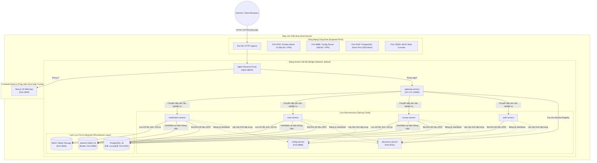
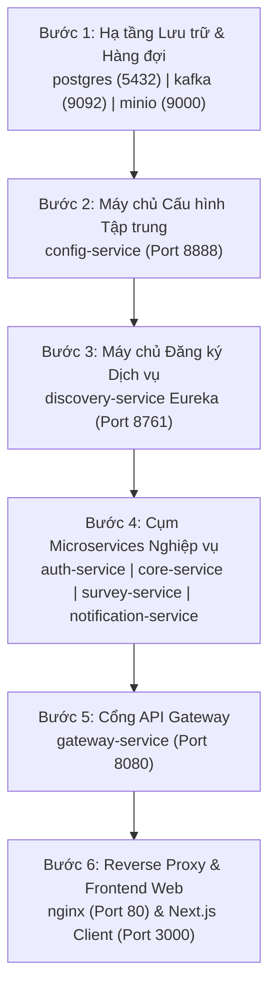

# HƯỚNG DẪN TRIỂN KHAI, VẬN HÀNH DEVOPS & BẢO TRÌ HỆ THỐNG
## (DEPLOYMENT, DEVOPS & INFRASTRUCTURE MANUAL)

> **Dự án:** Enterprise Survey Platform - Deployment & Infrastructure  
> **Nền tảng hạ tầng:** Docker Compose v2.x, Nginx Alpine, Linux / Windows Server  
> **Cơ sở dữ liệu:** PostgreSQL 16 Alpine  
> **Hàng đợi thông điệp:** Apache Kafka 3.8  
> **Lưu trữ đối tượng:** MinIO S3 Object Storage  
> **Cổng truy cập ngoài:** Port 80 (HTTP) / Port 443 (HTTPS)  

---

## MỤC LỤC
1. [SƠ ĐỒ HẠ TẦNG VẬN HÀNH (INFRASTRUCTURE TOPOLOGY)](#1-sơ-đồ-hạ-tầng-vận-hành-infrastructure-topology)
2. [BẢNG DANH MỤC BIẾN MÔI TRƯỜNG (.ENV)](#2-bảng-danh-mục-biến-môi-trường-env)
3. [QUY TRÌNH TRIỂN KHAI TỪ ĐẦU (STEP-BY-STEP DEPLOYMENT)](#3-quy-trình-triển-khai-từ-đầu-step-by-step-deployment)
   - [3.1. Yêu cầu Cấu hình Máy chủ (System Requirements)](#31-yêu-cầu-cấu-hình-máy-chủ-system-requirements)
   - [3.2. Trình tự Khởi động Dịch vụ (Dependencies Chain)](#32-trình-tự-khởi-động-dịch-vụ-dependencies-chain)
   - [3.3. Các Lệnh Thực thi Khởi động Toàn bộ Hệ thống](#33-các-lệnh-thực-thi-khởi-động-toàn-bộ-hệ-thống)
4. [CẤU HÌNH NGINX REVERSE PROXY](#4-cấu-hình-nginx-reverse-proxy)
5. [HƯỚNG DẪN VẬN HÀNH, GIÁM SÁT & BẢO TRÌ](#5-hướng-dẫn-vận-hành-giám-sát--bảo-trì)
   - [5.1. Giám sát Sức khỏe Dịch vụ (Health Checks & Dashboards)](#51-giám-sát-sức-khỏe-dịch-vụ-health-checks--dashboards)
   - [5.2. Sao lưu (Backup) & Phục hồi (Restore) Cơ sở Dữ liệu](#52-sao-lưu-backup--phục-hồi-restore-cơ-sở-dữ-liệu)
   - [5.3. Cấu hình Demo Từ xa qua Ngrok hoặc Cloudflare Tunnel](#53-cấu-hình-demo-từ-xa-qua-ngrok-hoặc-cloudflare-tunnel)
6. [HƯỚNG DẪN XỬ LÝ SỰ CỐ THƯỜNG GẶP (TROUBLESHOOTING GUIDE)](#6-hướng-dẫn-xử-lý-sự-cố-thường-gặp-troubleshooting-guide)

---

## 1. SƠ ĐỒ HẠ TẦNG VẬN HÀNH (INFRASTRUCTURE TOPOLOGY)

Hệ thống được đóng gói hoàn toàn trong mạng Docker ảo, giao tiếp nội bộ qua DNS tên dịch vụ và chỉ công khai cổng `80` (Nginx) ra ngoài Internet:



---

## 2. BẢNG DANH MỤC BIẾN MÔI TRƯỜNG (.ENV)

Tất cả các biến môi trường của hệ thống được quản lý trong file `.env` đặt tại thư mục gốc `BE_KhaoSat/`:

| Tên Biến | Mẫu Giá Trị | Bắt Buộc | Mục Đích Kỹ Thuật |
| :--- | :--- | :---: | :--- |
| **`POSTGRES_DB`** | `surveyDB` | Có | Tên database chính trong PostgreSQL |
| **`POSTGRES_USER`** | `postgres` | Có | Tên tài khoản quản trị PostgreSQL |
| **`POSTGRES_PASSWORD`** | `mat_khau_bao_mat_123` | Có | Mật khẩu truy cập PostgreSQL |
| **`JWT_SECRET`** | `KeyNayPhaiDaiHon32KyTuDeBaoMat123456` | Có | Khóa bí mật dùng để ký và giải mã JWT token (tối thiểu 32 ký tự HS256) |
| **`MINIO_ROOT_USER`** | `minioadmin` | Có | Tài khoản Root quản trị MinIO Object Storage |
| **`MINIO_ROOT_PASSWORD`** | `minioadmin_secret_key` | Có | Mật khẩu Root quản trị MinIO Object Storage |
| **`MINIO_BUCKET`** | `survey-media` | Không | Bucket lưu trữ ảnh khảo sát, chữ ký số (Mặc định: `survey-media`) |
| **`GOOGLE_CLIENT_ID`** | `xxx.apps.googleusercontent.com` | Tùy chọn | Google OAuth 2.0 Client ID (dùng cho tích hợp Google Forms/Sheets) |
| **`GOOGLE_CLIENT_SECRET`** | `GOCSPX-xxxx` | Tùy chọn | Google OAuth 2.0 Client Secret |
| **`GOOGLE_REDIRECT_URI`** | `http://localhost:3000/admin/google/callback` | Tùy chọn | Redirect URI đã đăng ký trên Google Cloud Console |
| **`GOOGLE_ENCRYPTION_SECRET`** | `KhoaBiMatMaHoaTokenGoogle32KyTu!` | Tùy chọn | Khóa bí mật mã hóa AES-256-GCM hai chiều các token Google |
| **`MAIL_USERNAME`** | `survey-notification@gmail.com` | Tùy chọn | Email tài khoản gửi thông báo qua SMTP |
| **`MAIL_PASSWORD`** | `app-specific-password` | Tùy chọn | Mật khẩu ứng dụng (App Password) của Gmail/SMTP |
| **`NOTIFICATION_BOUNCE_HOST`** | `imap.gmail.com` | Không | Máy chủ IMAP quét mail gửi lỗi (Mặc định: `imap.gmail.com`) |
| **`NOTIFICATION_BOUNCE_PORT`** | `993` | Không | Cổng SSL IMAP quét mail lỗi |
| **`TELEGRAM_BOT_TOKEN`** | `123456:ABC-DEF1234ghIkl-zyx57W2v1u123ew11` | Tùy chọn | Bot Token Telegram gửi thông báo |
| **`ZALO_BOT_TOKEN`** | `zalo-oa-access-token` | Tùy chọn | Zalo Official Account Access Token |

---

## 3. QUY TRÌNH TRIỂN KHAI TỪ ĐẦU (STEP-BY-STEP DEPLOYMENT)

### 3.1. Yêu cầu Cấu hình Máy chủ (System Requirements)
- **Hệ điều hành:** Ubuntu 22.04 LTS / Debian 12 / RHEL 9 hoặc Windows Server 2022.
- **Phần cứng đề xuất:**
  - CPU: Tối thiểu 4 Cores (Đề xuất 8 Cores).
  - RAM: Tối thiểu 8 GB RAM (Đề xuất 16 GB để chạy đồng thời cả 7 microservices Java và Kafka).
  - Ổ cứng: Tối thiểu 50 GB SSD trống.
- **Phần mềm bắt buộc cài đặt:**
  - Docker Engine v24.x trở lên.
  - Docker Compose v2.20 trở lên.
  - Node.js v20 LTS hoặc v22 LTS (cho Frontend client).

---

### 3.2. Trình tự Khởi động Dịch vụ (Dependencies Chain)

Các dịch vụ trong Spring Cloud có sự phụ thuộc chặt chẽ, phải khởi động theo chuỗi sau:



`docker-compose.yml` đã được cấu hình các khối `depends_on` với điều kiện `condition: service_healthy` để Docker tự động quản lý thứ tự khởi động này.

---

### 3.3. Các Lệnh Thực thi Khởi động Toàn bộ Hệ thống

#### Bước 1: Chuẩn bị Môi trường & Mã nguồn
```bash
# Di chuyển vào thư mục backend
cd /path/to/BE_KhaoSat

# Tạo file cấu hình môi trường từ mẫu
cp .env.example .env

# Chỉnh sửa file .env với thông tin mật khẩu thực tế
nano .env
```

#### Bước 2: Build & Khởi động cụm Docker Microservices
```bash
# Build tất cả các Docker images và chạy ngầm (detached mode)
docker compose up -d --build

# Kiểm tra trạng thái chạy của toàn bộ 11 containers
docker compose ps
```

*Kết quả mong đợi:* Tất cả các container hiển thị trạng thái `Up` (hoặc `Up (healthy)`).

#### Bước 3: Khởi động Frontend Client (Next.js)
```bash
cd /path/to/khaosat/client

# Cài đặt các gói phụ thuộc
npm install

# Chạy ở chế độ phát triển (Development)
npm run dev

# HOẶC Build và chạy ở chế độ Production:
npm run build
npm start
```

---

## 4. CẤU HÌNH NGINX REVERSE PROXY

Nginx đóng vai trò là cổng tiếp nhận duy nhất trên Port `80`:
- File cấu hình nằm tại: [`nginx.conf`](file:///d:/code/java/springboot/BE_KhaoSat/nginx.conf).

### Nguyên lý định tuyến thông minh:
1. **Toàn bộ API, Swagger, Webjars & Media:**
   Tự động gom chung bằng biểu thức chính quy Regex, chuyển tiếp thẳng vào API Gateway:
   ```nginx
   location ~* ^/(api|v3/api-docs|swagger|webjars|survey-media) {
       set $backend "http://gateway-service:8080";
       proxy_pass $backend;
       proxy_http_version 1.1;

       proxy_set_header Host $http_host;
       proxy_set_header X-Real-IP $remote_addr;
       proxy_set_header X-Forwarded-For $proxy_add_x_forwarded_for;
       proxy_set_header X-Forwarded-Proto $scheme;
   }
   ```
2. **Toàn bộ yêu cầu còn lại:**
   Chuyển tiếp đến Frontend Next.js trên cổng `3000`, hỗ trợ đầy đủ WebSocket Upgrade cho cơ chế Hot Module Replacement (HMR) của Next.js:
   ```nginx
   location / {
       set $frontend "http://frontend_client";
       proxy_pass $frontend;
       proxy_http_version 1.1;
       proxy_set_header Upgrade $http_upgrade;
       proxy_set_header Connection $connection_upgrade;
   }
   ```

---

## 5. HƯỚNG DẪN VẬN HÀNH, GIÁM SÁT & BẢO TRÌ

### 5.1. Giám sát Sức khỏe Dịch vụ (Health Checks & Dashboards)
Quản trị viên có thể kiểm tra trực quan các công cụ quản trị sau:
- **Eureka Service Registry Dashboard:** Truy cập `http://<server-ip>:8761`. Xem danh sách các microservice đã đăng ký và số lượng instance đang sống.
- **MinIO Object Storage Console:** Truy cập `http://<server-ip>:19000` (đăng nhập bằng `MINIO_ROOT_USER` và `MINIO_ROOT_PASSWORD`). Quản lý các bucket `survey-media` và `notification-attachments`.
- **Kiểm tra Logs thời gian thực của Microservice bất kỳ:**
  ```bash
  # Xem log của survey-service
  docker compose logs -f survey-service

  # Xem log của gateway-service
  docker compose logs -f gateway-service
  ```

---

### 5.2. Sao lưu (Backup) & Phục hồi (Restore) Cơ sở Dữ liệu

#### Lệnh Sao lưu Database (Backup):
```bash
# Tạo file backup nén chứa toàn bộ schema và dữ liệu
docker compose exec -t postgres pg_dump -U postgres surveyDB | gzip > backup_survey_$(date +%Y%m%d_%H%M%S).sql.gz
```

#### Lệnh Phục hồi Database (Restore):
```bash
# Giải nén và nạp lại dữ liệu vào database
gunzip -c backup_survey_20261110_100000.sql.gz | docker compose exec -T postgres psql -U postgres -d surveyDB
```

---

### 5.3. Cấu hình Demo Từ xa qua Ngrok hoặc Cloudflare Tunnel

Hệ thống được thiết kế linh hoạt để có thể demo từ xa cho đối tác/khách hàng qua đường truyền ngoài mà **hoàn toàn không cần sửa đổi bất kỳ dòng code hay cấu hình URL nào**:
- **Ngrok:**
  ```bash
  # Mở tunnel trực tiếp vào cổng 80 của Nginx
  ngrok http 80
  ```
  Nhờ cấu hình `NEXT_PUBLIC_API_URL=` để trống trong `client/.env.local`, trình duyệt sẽ tự động gọi API theo đường dẫn tương đối `/api` dựa trên tên miền ngrok hiện tại.

- **Cloudflare Tunnel (Khuyến nghị cho Production Demo):**
  ```bash
  cloudflared tunnel run --url http://localhost:80 my-survey-demo
  ```

---

## 6. HƯỚNG DẪN XỬ LÝ SỰ CỐ THƯỜNG GẶP (TROUBLESHOOTING GUIDE)

### Sự cố 1: `survey-service` khởi động thất bại hoặc liên tục restart
- **Triệu chứng:** Log hiển thị `Fetching config from server at: http://config-service:8888` sau đó bị timeout hoặc từ chối kết nối.
- **Nguyên nhân:** Container `config-service` chưa hoàn thành khởi động hoặc chưa đọc xong `config-repo`.
- **Cách khắc phục:**
  ```bash
  # Khởi động riêng config-service trước
  docker compose up -d config-service
  # Chờ 10 giây, sau đó khởi động các service còn lại
  docker compose up -d
  ```

### Sự cố 2: Lỗi 401 Unauthorized khi gọi API khảo sát
- **Triệu chứng:** Frontend nhận lỗi 401 mặc dù đã đăng nhập.
- **Nguyên nhân:** Token JWT bị hết hạn (Access Token có hạn 10 giờ) hoặc khóa bí mật `JWT_SECRET` trong `.env` bị thay đổi so với lúc sinh token.
- **Cách khắc phục:** Đăng xuất và đăng nhập lại trên giao diện để nhận Token mới. Kiểm tra đảm bảo tất cả các container dùng chung một giá trị `JWT_SECRET` trong `.env`.

### Sự cố 3: Lỗi Nginx trả về `502 Bad Gateway`
- **Triệu chứng:** Truy cập `http://localhost/` hoặc `http://localhost/api/...` nhận màn hình 502 Bad Gateway của Nginx.
- **Nguyên nhân:** Container `gateway-service` hoặc tiến trình `Next.js client` chưa chạy.
- **Cách khắc phục:**
  1. Kiểm tra container Gateway: `docker compose ps gateway-service`. Nếu đang stop, khởi động lại: `docker compose restart gateway-service`.
  2. Kiểm tra Next.js client trên máy host: đảm bảo port `3000` đang lắng nghe (`Get-NetTCPConnection -LocalPort 3000`).

### Sự cố 4: Lỗi Redirect URI Mismatch khi liên kết tài khoản Google
- **Triệu chứng:** Google OAuth hiển thị thông báo lỗi `Error 400: redirect_uri_mismatch`.
- **Nguyên nhân:** Tên miền truy cập thực tế (ví dụ: ngrok domain hoặc domain sản xuất) chưa được khai báo trong mục *Authorized redirect URIs* trên Google Cloud Console.
- **Cách khắc phục:** Truy cập [Google Cloud Console](https://console.cloud.google.com/apis/credentials), tìm OAuth 2.0 Client ID của dự án, thêm chính xác URL callback: `https://<ten-mien-cua-ban>/admin/google/callback` và cập nhật lại biến `GOOGLE_REDIRECT_URI` trong `.env`.

