# KIẾN TRÚC CHUYÊN SÂU FRONTEND CLIENT & BỘ CÔNG CỤ BIỂU MẪU
## (FRONTEND ARCHITECTURE MANUAL & FORM BUILDER ENGINE)

> **Dự án:** Enterprise Survey Platform - Web Client  
> **Ngôn ngữ:** TypeScript 5.x / JavaScript ECMAScript 2024  
> **Framework:** Next.js 16 (Turbopack, App Router)  
> **Giao diện & UI:** React 19, Tailwind CSS v4, Lucide React, React Icons  
> **Biểu đồ & Trực quan hóa:** Apache ECharts 6 (`echarts`), React ApexCharts, Recharts  
> **Kéo thả & Tương tác:** DnD Kit (`@dnd-kit/core`, `@dnd-kit/sortable`, `@dnd-kit/utilities`)  

---

## MỤC LỤC
1. [TỔNG QUAN NỀN TẢNG & KIẾN TRÚC FRONTEND](#1-tổng-quan-nền-tảng--kiến-trúc-frontend)
2. [CẤU TRÚC THƯ MỤC & PHÂN PHỐI TRÁCH NHIỆM](#2-cấu-trúc-thư-mục--phân-phối-trách-nhiệm)
3. [FORM BUILDER ENGINE (TRÌNH THIẾT KẾ BIỂU MẪU CAO CẤP)](#3-form-builder-engine-trình-thiết-kế-biểu-mẫu-cao-cấp)
   - [3.1. Floating Dock & Toolbar Chuẩn Figma](#31-floating-dock--toolbar-chuẩn-figma)
   - [3.2. Bảng Màu Câu Hỏi (Question Palette) & Kéo Thả DnD Kit](#32-bảng-màu-câu-hỏi-question-palette--kéo-thả-dnd-kit)
   - [3.3. Bộ Cấu Hình Câu Hỏi Ma Trận & Bảng Động (Matrix & Dynamic Table)](#33-bộ-cấu-hình-câu-hỏi-ma-trận--bảng-động-matrix--dynamic-table)
   - [3.4. Trình Thiết Lập Ràng Buộc Câu Hỏi (Validation Rules Editor)](#34-trình-thiết-lập-ràng-buộc-câu-hỏi-validation-rules-editor)
   - [3.5. Trình Cấu Hình Vai Trò Tính Toán & Tiêu Chí Cha-Con (Calculation Roles)](#35-trình-cấu-hình-vai-trò-tính-toán--tiêu-chí-cha-con-calculation-roles)
4. [SURVEY TAKING ENGINE (TRÌNH LÀM BÀI KHẢO SÁT PHẢN ỨNG)](#4-survey-taking-engine-trình-làm-bài-khảo-sát-phản-ứng)
   - [4.1. Cơ chế Multi-Page Stepper & Tiến trình](#41-cơ-chế-multi-page-stepper--tiến-trình)
   - [4.2. Hệ thống Xác thực Client-Side Thời gian thực](#42-hệ-thống-xác-thực-client-side-thời-gian-thực)
   - [4.3. Tối ưu hóa Trải nghiệm Mobile & Desktop](#43-tối-ưu-hóa-trải-nghiệm-mobile--desktop)
5. [HỆ THỐNG BÁO CÁO & PHÂN TÍCH ĐA CHIỀU (ANALYTICS & REPORTING HUB)](#5-hệ-thống-báo-cáo--phân-tích-đa-chiều-analytics--reporting-hub)
   - [5.1. Dashboard Tổng quan & Biểu đồ Lưu lượng (Timeline)](#51-dashboard-tổng-quan--biểu-đồ-lưu-lượng-timeline)
   - [5.2. Phân tích Câu hỏi & ECharts Switcher (Donut, Bar, Rose)](#52-phân-tích-câu-hỏi--echarts-switcher-donut-bar-rose)
   - [5.3. Phân bố Khoảng giá trị Động (Dynamic Range Histogram)](#53-phân-bố-khoảng-giá-trị-động-dynamic-range-histogram)
   - [5.4. Báo Cáo Tùy Chỉnh Đa Khối & Đa Biểu Đồ (CustomReportTab)](#54-báo-cáo-tùy-chỉnh-đa-khối--đa-biểu-đồ-customreporttab)
   - [5.5. Biểu Đồ Đường Xu Hướng Đa Nhóm (Multi-line Group Pivot)](#55-biểu-đồ-đường-xu-hướng-đa-nhóm-multi-line-group-pivot)
   - [5.6. Ngăn kéo Khoan sâu Dữ liệu (Drill-Down Response Drawer)](#56-ngăn-kéo-khoan-sâu-dữ-liệu-drill-down-response-drawer)
   - [5.7. Danh sách Phản hồi Chi tiết & Xuất Báo cáo Excel Đa Khối](#57-danh-sách-phản-hồi-chi-tiết--xuất-báo-cáo-excel-đa-khối)
6. [TÍCH HỢP GOOGLE WORKSPACE TRÊN GIAO DIỆN](#6-tích-hợp-google-workspace-trên-giao-diện)
7. [QUẢN LÝ TRẠNG THÁI (STATE MANAGEMENT) & BẢO MẬT CLIENT](#7-quản-lý-trạng-thái-state-management--bảo-mật-client)

---

## 1. TỔNG QUAN NỀN TẢNG & KIẾN TRÚC FRONTEND

Ứng dụng Frontend được thiết kế với tiêu chuẩn hiện đại nhất của hệ sinh thái React:
- **Next.js 16 App Router:** Phân chia rõ ràng giữa Server Components (tối ưu SEO, render nhanh cấu trúc trang ban đầu) và Client Components (`"use client"`) cho các phân hệ tương tác cao (Form Builder, Interactive Charts, Drawer).
- **Turbopack:** Tăng tốc độ biên dịch cục bộ (Fast Refresh) gấp 5-10 lần so với Webpack truyền thống.
- **Tailwind CSS v4:** Sử dụng hệ thống design token nhất quán, hỗ trợ đầy đủ chế độ Sáng / Tối (Dark Mode) tự động theo hệ thống hoặc toggle người dùng.
- **Kiến trúc Modular UI:** Các thành phần giao diện được chia nhỏ thành các atomic component có thể tái sử dụng tối đa, kiểm soát chặt chẽ Type-safety qua TypeScript interfaces.

---

## 2. CẤU TRÚC THƯ MỤC & PHÂN PHỐI TRÁCH NHIỆM

```
client/src/
├── app/                                    # Next.js App Router (Routing Tree)
│   ├── (auth)/                             # Nhóm route xác thực (Login, Register)
│   ├── admin/                              # Phân khu Quản trị & Nghiệp vụ Khảo sát
│   │   ├── survey/
│   │   │   ├── [id]/
│   │   │   │   ├── edit/page.tsx           # Trình thiết kế biểu mẫu (Survey Form Builder)
│   │   │   │   ├── result/page.tsx         # Bảng phân tích kết quả & Dashboard khảo sát
│   │   │   └── manage/page.tsx             # Danh sách quản lý các biểu mẫu khảo sát
│   │   └── users/                          # Quản lý người dùng, phân quyền RBAC
│   ├── survey/[id]/page.tsx                # Trang công khai dành cho Người làm bài (Survey Taking)
│   ├── layout.tsx                          # Root Layout (Theme Provider, Font Inter)
│   └── globals.css                         # Tailwind CSS imports & Custom utilities
├── components/                             # Thư viện UI Components
│   ├── charts/
│   │   └── EChartsContainer.tsx            # Wrapper ECharts React 19 SSR-safe, hỗ trợ Dark Mode & Events
│   ├── surveys/                            # Phân hệ Thiết kế Biểu mẫu (Form Builder)
│   │   ├── FigmaSurveyFloatingDock.tsx     # Thanh công cụ nổi kiểu Figma
│   │   ├── QuestionPalette.tsx             # Bảng chọn các loại câu hỏi
│   │   ├── MatrixQuestionEditor.tsx        # Trình dựng bảng ma trận & bảng động
│   │   ├── ValidationRulesEditor.tsx       # Modal thiết lập điều kiện ràng buộc
│   │   ├── CalculationRolesEditor.tsx      # Modal thiết lập vai trò tính toán & tiêu chí con-cha
│   │   └── GoogleAccountManagerModal.tsx   # Modal quản lý liên kết tài khoản Google
│   └── result/                             # Phân hệ Phân tích & Báo cáo Số liệu
│       ├── SurveyDashboardTab.tsx          # Tab Dashboard tổng quan
│       ├── SummaryTab.tsx                  # Tab Phân tích câu hỏi (ECharts, Histogram, Grouping)
│       ├── ScoreRangeHistogram.tsx         # Biểu đồ phân bố dải điểm & lọc khoảng
│       ├── SmartGroupingAnalytics.tsx      # Công cụ Gom nhóm thông minh & So sánh đa chiều
│       ├── DrillDownResponseDrawer.tsx     # Drawer trượt xem danh sách bài làm chi tiết
│       ├── MatrixSummary.tsx               # Bảng tổng hợp số liệu ma trận
│       ├── ResponseListTab.tsx             # Tab danh sách bài làm chi tiết
│       └── FilterTab.tsx                   # Bộ lọc ngày & câu hỏi
├── lib/                                    # Tiện ích, Kết nối API & Formatters
│   ├── api.ts                              # Base API URLs, Fetch wrapper, Bearer token injection
│   ├── auth.ts                             # Quản lý JWT Token trong localStorage / Cookie
│   └── report.ts                           # Hàm định dạng số liệu, tính ngày tháng, format múi giờ VN
└── types/                                  # Khai báo kiểu TypeScript (Data Contracts)
    ├── report.ts                           # Kiểu dữ liệu Báo cáo, Thống kê, DatasetRecord, Filter
    ├── survey.ts                           # Kiểu dữ liệu Cấu trúc Biểu mẫu, Question, Page, Matrix
    └── survey-dashboard.ts                 # Kiểu dữ liệu Dashboard, Timeline
```

---

## 3. FORM BUILDER ENGINE (TRÌNH THIẾT KẾ BIỂU MẪU CAO CẤP)

### 3.1. Floating Dock & Toolbar Chuẩn Figma
- Nằm tại [`FigmaSurveyFloatingDock.tsx`](file:///d:/code/react/khaosat/client/src/components/surveys/FigmaSurveyFloatingDock.tsx).
- Thanh công cụ nổi (Floating Dock) tự động neo ở đáy màn hình hoặc đỉnh trang, mang phong cách giao diện Figma hiện đại.
- Cung cấp các thao tác 1-click:
  - `+ Thêm câu hỏi`: Mở nhanh bảng chọn loại câu hỏi.
  - `+ Thêm trang mới`: Hỗ trợ khảo sát đa trang (Multi-page survey).
  - `Xem trước (Preview)`: Xem giao diện thực tế trên cả 2 chế độ Mobile và Desktop.
  - `Lưu thay đổi (Save)`: Lưu toàn bộ biểu mẫu xuống backend qua 1 transactional request `PUT /api/surveys/{id}`.
  - `Chia sẻ / Xuất bản (Publish)`: Lấy link làm bài công khai, mã QR code hoặc nhúng iframe.

---

### 3.2. Bảng Màu Câu Hỏi (Question Palette) & Kéo Thả DnD Kit
- Nằm tại [`QuestionPalette.tsx`](file:///d:/code/react/khaosat/client/src/components/surveys/QuestionPalette.tsx).
- Phân nhóm trực quan hơn 16 loại câu hỏi theo 4 danh mục:
  1. **Nhập văn bản (Text Inputs):** Đoạn ngắn (Short Text), Đoạn văn dài (Paragraph/Long Text).
  2. **Lựa chọn (Choice & Options):** Trắc nghiệm chọn 1 (Single Choice / Radio), Trắc nghiệm chọn nhiều (Multiple Choice / Checkbox), Danh sách thả xuống (Dropdown).
  3. **Đo lường & Số học (Metrics & Scoring):** Điểm số (Number), Đánh giá sao/thang điểm (Rating 1-5, 1-10), Ngày (Date), Giờ (Time).
  4. **Nâng cao & Bảng biểu (Advanced & Matrix):** Bảng ma trận 1 lựa chọn (`MATRIX_SINGLE`), Bảng ma trận chọn nhiều (`MATRIX_MULTI`), Ma trận nhập liệu (`MATRIX_INPUT`), Bảng nhập liệu động (`DYNAMIC_TABLE`), Địa chỉ hành chính Việt Nam (`ADDRESS`), Chữ ký số điện tử (`SIGNATURE`), Tải tệp lên (`FILE_UPLOAD`).
- Tích hợp thư viện `@dnd-kit/core` và `@dnd-kit/sortable` cho phép người dùng nhấp giữ chuột để kéo thả, thay đổi vị trí câu hỏi trên biểu mẫu tức thì với hiệu ứng animation mượt mà.

---

### 3.3. Bộ Cấu Hình Câu Hỏi Ma Trận & Bảng Động (Matrix & Dynamic Table)
- Cho phép người tạo khảo sát thêm/sửa/xóa không giới hạn các **Hàng tiêu chí (Rows)** và **Cột đánh giá (Columns)**.
- Giao diện trực quan cho phép gán trọng số hoặc điểm số (`score_value`) cho từng cột để tự động chấm điểm bài làm.
- Với **`DYNAMIC_TABLE`**, quản trị viên có thể định nghĩa các cột form (ví dụ: Cột Họ tên [text], Cột Năm sinh [number], Cột Giới tính [dropdown]), người làm bài sẽ tự động thêm bao nhiêu dòng tùy ý khi điền thực tế.

---

### 3.4. Trình Thiết Lập Ràng Buộc Câu Hỏi (Validation Rules Editor)
- Nằm tại [`ValidationRulesEditor.tsx`](file:///d:/code/react/khaosat/client/src/components/surveys/ValidationRulesEditor.tsx).
- Cho phép gán các quy tắc kiểm tra nghiêm ngặt:
  - Ràng buộc độ dài ký tự tối thiểu / tối đa.
  - Ràng buộc giá trị số nhỏ nhất / lớn nhất.
  - Kiểm tra định dạng số điện thoại Việt Nam hợp lệ.
  - Kiểm tra định dạng email doanh nghiệp.
  - Tùy chỉnh biểu thức chính quy (Custom Regex Pattern) kèm thông báo lỗi thân thiện khi người dùng nhập sai.

---

### 3.5. Trình Cấu Hình Vai Trò Tính Toán & Tiêu Chí Cha-Con (Calculation Roles)
- Cho phép phân cấp câu hỏi thành cây đa tầng (Tiêu chuẩn $\rightarrow$ Tiêu chí con $\rightarrow$ Chỉ số đo lường).
- Cho phép cấu hình phương thức tổng hợp số liệu:
  - Cộng dồn tự động (`SUM`).
  - Lấy điểm trung bình cộng (`AVG`).
  - Tính theo trọng số phần trăm (`WEIGHTED`).
  - Viết công thức toán học (`FORMULA`).

---

## 4. SURVEY TAKING ENGINE (TRÌNH LÀM BÀI KHẢO SÁT PHẢN ỨNG)

### 4.1. Cơ chế Multi-Page Stepper & Tiến trình
- Nằm tại [`app/survey/[id]/page.tsx`](file:///d:/code/react/khaosat/client/src/app/survey/[id]/page.tsx).
- Với các khảo sát dài có nhiều trang (`Page`), hệ thống hiển thị thanh tiến trình hoàn thành (Progress Bar %) và bộ chuyển trang Stepper.
- Lưu trữ tạm thời câu trả lời vào `sessionStorage` của trình duyệt để phòng ngừa rủi ro mất dữ liệu khi người làm bài vô tình F5 làm mới trang.

### 4.2. Hệ thống Xác thực Client-Side Thời gian thực
- Khi người làm bài chuyển trang hoặc bấm "Nộp bài", hệ thống tự động duyệt qua tất cả các câu hỏi bắt buộc (`isRequired = true`) và các quy tắc `validationRules`.
- Nếu có lỗi, trang sẽ tự động cuộn (smooth scroll) đến câu hỏi bị lỗi đầu tiên và hiển thị viền đỏ kèm thông điệp cảnh báo rõ ràng.

### 4.3. Tối ưu hóa Trải nghiệm Mobile & Desktop
- Thiết kế Responsive 100% dựa trên Tailwind CSS (`sm:`, `md:`, `lg:` breakpoints).
- Các câu hỏi bảng ma trận phức tạp khi hiển thị trên màn hình điện thoại di động sẽ tự động chuyển đổi từ dạng bảng lưới ngang (Grid) sang dạng các Card tiêu chí dọc, giúp người dùng chạm và chọn bằng ngón tay cực kỳ dễ dàng, không bị vỡ layout hay phải cuộn ngang.

---

## 5. HỆ THỐNG BÁO CÁO & PHÂN TÍCH ĐA CHIỀU (ANALYTICS & REPORTING HUB)

Nằm tại trang kết quả khảo sát [`app/admin/survey/[id]/result/page.tsx`](file:///d:/code/react/khaosat/client/src/app/admin/survey/[id]/result/page.tsx), hệ thống cung cấp 3 tab làm việc chuyên sâu:

```mermaid
flowchart TD
    ResultPage["Trang Báo Cáo Khảo Sát (/admin/survey/[id]/result)"]

    ResultPage --> Tab1["1. Tab Tổng quan (SurveyDashboardTab)"]
    ResultPage --> Tab2["2. Tab Phân tích câu hỏi (SummaryTab)"]
    ResultPage --> Tab3["3. Tab Báo cáo tùy chỉnh (CustomReportTab)"]
    ResultPage --> Tab4["4. Tab Phản hồi (ResponseListTab)"]

    Tab1 --> DashMetrics["Thống kê tổng: Lượt xem, Lượt nộp, Tỷ lệ hoàn thành, Thời gian làm bài"]
    Tab1 --> DashTimeline["Biểu đồ đường Timeline lưu lượng theo ngày & giờ"]

    Tab2 --> SummaryCards["Phân tích câu hỏi chuẩn & Tự động sinh thẻ thống kê cho Cột tự tạo/Công thức"]
    Tab2 --> ChoiceCharts["Biểu đồ trắc nghiệm: Vành khăn, Cột, Hoa hồng (ECharts)"]
    Tab2 --> NumberHisto["Phân bố khoảng giá trị tự động (ScoreRangeHistogram)"]
    Tab2 --> StatCards["Thẻ thống kê click tương tác: TB, Trung vị, Min, Max"]

    Tab3 --> ViewSubPage["Trang 1: Chỉ xem (Lưới Responsive, Thẻ KPI, Biểu đồ & Bảng sạch sẽ)"]
    Tab3 --> SetupSubPage["Trang 2: Thiết lập (Studio 2 vùng Master-Detail, Live Preview)"]
    Tab3 --> MultiLineChart["Biểu đồ Đường xu hướng đa nhóm (Multi-line Group Pivot)"]
    Tab3 --> SetupSaveBtn["Nút 'Lưu mẫu báo cáo' trực tiếp trong phòng Thiết lập"]
    Tab3 --> MultiViews["Lưu trữ nhiều bản cấu hình độc lập trong 1 khảo sát (JSONB custom_dashboard)"]

    SummaryCards --> Drawer["Drill-Down Response Drawer (Trượt từ cạnh phải)"]
    StatCards --> Drawer
    NumberHisto --> Drawer
    ChoiceCharts --> Drawer
    Tab3 --> Drawer

    Tab4 --> TableView["Bảng phản hồi đồng bộ bộ lọc (ResponseListTab, Phân trang, Tìm kiếm)"]
    Tab3 --> ExportModal["Xuất báo cáo đa khối ExcelJS: Sheet Tong_quan, Tong_hop_cac_khoi, Du_lieu_chi_tiet"]
```



---

### 5.1. Dashboard Tổng quan & Biểu đồ Lưu lượng (Timeline)
- Nằm tại [`SurveyDashboardTab.tsx`](file:///d:/code/react/khaosat/client/src/components/result/SurveyDashboardTab.tsx).
- Hiển thị 4 chỉ số sinh mệnh của khảo sát: Tổng lượt phản hồi, Tỷ lệ hoàn thành (Completion Rate %), Thời gian hoàn thành trung bình (Average Active Duration), và Số trang trung bình đã xem.
- Biểu đồ đường diện tích (Area Line Chart) thể hiện lưu lượng bài nộp theo từng mốc thời gian, giúp nhận biết các khung giờ cao điểm người dùng phản hồi.

---

### 5.2. Phân tích Câu hỏi & ECharts Switcher (Donut, Bar, Rose)
- Nằm tại [`SummaryTab.tsx`](file:///d:/code/react/khaosat/client/src/components/result/SummaryTab.tsx).
- Với các câu hỏi trắc nghiệm, người dùng có thể linh hoạt chuyển đổi giữa 3 dạng biểu đồ:
  - **Biểu đồ cột (Bar Chart):** So sánh số lượng tuyệt đối.
  - **Biểu đồ vành khăn (Donut Chart):** Thể hiện tỷ trọng cơ cấu phần trăm.
  - **Biểu đồ hoa hồng (Nightingale Rose Chart):** Trực quan hóa thẩm mỹ cao cho các tập dữ liệu có độ phân hóa lớn.
- Tích hợp tính năng xuất ảnh biểu đồ trực tiếp (Save as Image) chỉ với một nút bấm.
- **Tự động sinh thẻ thống kê cho Cột tự tạo & Công thức Excel:** Khi người dùng định nghĩa cột tính toán (qua `ComputedFieldsDrawer`), `SummaryTab` tự động sinh các card phân tích chuyên biệt:
  - Cột công thức dạng Số: Hiển thị 4 chỉ số (TB, Trung vị, Min, Max), biểu đồ phân bố và liên kết Drill-down bài nộp tương ứng.
  - Cột công thức dạng Phân loại / Boolean / Date: Hiển thị biểu đồ phân bố tần suất và bảng tỷ lệ lựa chọn.

---

### 5.3. Phân bố Khoảng giá trị Động (Dynamic Range Histogram)
- Nằm tại [`ScoreRangeHistogram.tsx`](file:///d:/code/react/khaosat/client/src/components/result/ScoreRangeHistogram.tsx).
- Sử dụng thuật toán chia khoảng tự thích ứng [`buildDynamicEqualWidthRanges`](file:///d:/code/react/khaosat/client/src/lib/report-engine/computed.ts) cho mọi câu hỏi số học (điểm thi, mức độ hài lòng `1..5`, doanh số, tuổi, thời lượng):
  - **5 khoảng tự động / 10 khoảng tự động:** Tự động tính bước nhảy đẹp dựa trên min–max thực tế của dữ liệu đang lọc.
  - **Chế độ Tùy biến khoảng:** Nhập ngưỡng `Từ giá trị` – `Đến giá trị` bất kỳ để đếm số phản hồi khớp và mở danh sách ngay lập tức.
- Nhấp trực tiếp vào cột ECharts hoặc thẻ khoảng giá trị sẽ mở [`DrillDownResponseDrawer.tsx`](file:///d:/code/react/khaosat/client/src/components/result/DrillDownResponseDrawer.tsx).

---

### 5.4. Báo Cáo Tùy Chỉnh Đa Khối & Đa Biểu Đồ (CustomReportTab)
- Nằm tại [`CustomReportTab.tsx`](file:///d:/code/react/khaosat/client/src/components/result/report-builder/CustomReportTab.tsx), tạo thành tab độc lập thứ 3 trong trung tâm phân tích.
- **Hai chế độ hoạt động tách biệt (`subPage: "view" | "setup"`):**
  - **Chế độ Chỉ xem (`view`):**
    - Giao diện báo cáo điều hành sạch sẽ, trực quan, không có các nút cấu hình gây rối mắt.
    - Lưới Responsive 12 cột tự động bố trí các khối (`half` = 2 khối/hàng, `full` = 1 khối/hàng).
    - Hỗ trợ các dạng khối: **Thẻ KPI tổng hợp (`KpiWidgetCard`)**, **Biểu đồ độc lập (`onlyChart`)**, **Bảng tổng hợp độc lập (`onlyTable`)**, hoặc **Biểu đồ & Bảng kết hợp (`chartAndTable`)**.
    - Nhấp vào bất kỳ cột, đường, lát tròn hoặc ô KPI nào đều kích hoạt Drill-Down xem danh sách bài làm chi tiết.
  - **Chế độ Thiết lập (`setup`) - Bố cục Studio 2 vùng (Master-Detail):**
    - **Cột trái (280-320px):** Danh sách toàn bộ các khối hiện tại, cho phép đổi thứ tự Lên/Xuống, xóa, nhân bản (Duplicate) hoặc thêm khối mới (+ Biểu đồ, + Bảng tổng hợp, + Thẻ KPI).
    - **Vùng làm việc phải:** Trình cấu hình chi tiết cho khối đang chọn: đặt tên, chọn kiểu hiển thị, tùy chọn bỏ qua bộ lọc chung (`ignoreGlobalFilter`), chọn loại biểu đồ (Cột nhóm, Cột chồng, Thanh ngang, Đường xu hướng, Donut, Phân bố Min/TB/Max), Gom nhóm 0..3 cấp, Cột chỉ số đo lường, Bộ lọc riêng cho từng khối (`FilterBuilderBar`), và khung **Xem trước trực tiếp (Live Preview)** cập nhật tức thì.
  - **Nút "Lưu mẫu báo cáo" ngay trong phòng Thiết lập:**
    - Cụm nút trên Header của phòng Thiết lập cho phép bấm **Lưu thay đổi** (kèm cảnh báo chấm màu khi có thay đổi chưa lưu) hoặc **Lưu bản sao / Lưu mẫu mới** ngay khi đang cấu hình mà không cần chuyển ra trang Xem.
    - Hỗ trợ lưu trữ nhiều bản thiết lập báo cáo tùy chỉnh độc lập (`reportKind: "custom_dashboard"`, `version: 2`) trong cùng một khảo sát vào backend qua bảng `report_views` (cột `definition_json` JSONB).

---

### 5.5. Biểu Đồ Đường Xu Hướng Đa Nhóm (Multi-line Group Pivot)
- Nằm tại [`ResultChartView.tsx`](file:///d:/code/react/khaosat/client/src/components/result/report-builder/ResultChartView.tsx).
- Tự động kích hoạt khi chọn loại biểu đồ là **Đường xu hướng (`line`)** và cấu hình **2 chiều Gom nhóm** (`output.pivotMatrix`):
  - **Trục hoành (X-axis):** Chiều gom nhóm 1 (ví dụ: các mốc điểm trung bình từ 1 đến 10).
  - **Trục tung (Y-axis):** Số lượng phản hồi (`count`) hoặc giá trị đo lường (`avg`, `sum`).
  - **Các đường (Series):** Từng nhóm thuộc Chiều gom nhóm 2 (ví dụ: Đường 1 là KHTN, Đường 2 là KHXH; hoặc từng Lớp, từng Khối).
  - Màu sắc phân biệt tự động theo bảng màu `ECHARTS_PALETTE`, hỗ trợ `smooth: true`, `symbol: "circle"`, đường vẽ dày `2.5px`.
  - **Tooltip so sánh trục hoành:** Hiển thị tức thì giá trị của tất cả các đường tại mốc điểm đang rê chuột.
  - **Drill-Down chính xác:** Nhấp vào điểm dữ liệu trên đường để mở danh sách phản hồi khớp chính xác với mốc điểm & nhóm tương ứng.
  - **Tự động gắn tiền tố `[Tên trang]`:** Khi khảo sát có từ 2 trang trở lên, hệ thống tự động tiền tố `[Tên trang]` vào trước tên câu hỏi để phân biệt rạch ròi các câu hỏi trùng tên (như `[Điểm KHTN] Điểm trung bình` vs `[Tổ hợp khoa học xã hội] Điểm trung bình`).

---

### 5.6. Ngăn kéo Khoan sâu Dữ liệu (Drill-Down Response Drawer)
- Nằm tại [`DrillDownResponseDrawer.tsx`](file:///d:/code/react/khaosat/client/src/components/result/DrillDownResponseDrawer.tsx).
- Hoạt động mượt mà với cơ chế trượt từ cạnh phải màn hình (Sliding Drawer):
  - **Khi nhấp vào thẻ thống kê:** Nhấp "Cao nhất" hiển thị các bài làm đạt điểm tối đa; nhấp "Thấp nhất" hiển thị bài làm có điểm tối thiểu.
  - **Khi nhấp vào biểu đồ / nhóm:** Hiển thị danh sách các bài làm thuộc nhóm hoặc dải điểm đó.
  - **Tính năng nổi bật:**
    - Tích hợp ô tìm kiếm bài làm theo từ khóa tức thì.
    - Tự động nhận diện câu hỏi định danh (Họ tên, Lớp/Phòng ban) để gắn huy hiệu lên từng card bài làm.
    - Đánh dấu màu nổi bật câu trả lời của câu hỏi mục tiêu.
    - Nút "Xem bài làm" dẫn trực tiếp đến trang xem chi tiết toàn bộ bài khảo sát.

---

### 5.7. Danh sách Phản hồi Chi tiết & Xuất Báo cáo Excel Đa Khối
- Nằm tại [`ResponseListTab.tsx`](file:///d:/code/react/khaosat/client/src/components/result/ResponseListTab.tsx) và [`ExportReportModal.tsx`](file:///d:/code/react/khaosat/client/src/components/result/report-builder/ExportReportModal.tsx).
- Hiển thị danh sách toàn bộ các bài nộp dưới dạng bảng phân trang (Pagination).
- **Xuất Excel Đa Khối nâng cao qua `exceljs` ([`excel.ts`](file:///d:/code/react/khaosat/client/src/lib/report-export/excel.ts)):**
  - Khi xuất báo cáo từ tab Báo cáo tùy chỉnh, file `.xlsx` tự động tạo 3 sheet:
    1. `Tong_quan`: Thông tin khảo sát, tên báo cáo, điều kiện lọc chung, danh sách cột công thức.
    2. `Tong_hop_cac_khoi`: Xuất dữ liệu bảng của toàn bộ các khối trong thiết lập báo cáo tùy chỉnh, giữ nguyên định dạng số và màu sắc highlight nhóm cao nhất / thấp nhất.
    3. `Du_lieu_chi_tiet`: Danh sách phản hồi chi tiết khớp với bộ lọc.
- Cung cấp 2 nút tải file Excel chuẩn:
  - `Xuất dữ liệu gốc (responses.xlsx)`: Tải toàn bộ dữ liệu thô phục vụ xử lý trên Excel, SPSS.
  - `Xuất báo cáo phân tích (analysis.xlsx)`: Tải báo cáo phân tích tổng hợp có áp dụng bộ lọc hiện tại.

---

## 6. TÍCH HỢP GOOGLE WORKSPACE TRÊN GIAO DIỆN
- Nằm tại [`GoogleAccountManagerModal.tsx`](file:///d:/code/react/khaosat/client/src/components/surveys/GoogleAccountManagerModal.tsx).
- Cho phép người dùng liên kết tài khoản Google cá nhân hoặc doanh nghiệp qua OAuth 2.0.
- Nút **"Đồng bộ phản hồi Google Forms"** cho phép quản trị viên kích hoạt đồng bộ bất kỳ lúc nào, hiển thị thông báo thành công kèm số lượng phản hồi mới được nạp vào hệ thống.

---

## 7. QUẢN LÝ TRẠNG THÁI (STATE MANAGEMENT) & BẢO MẬT CLIENT
- **Quản lý Token:** Lưu trữ Access Token trong `localStorage` qua module [`lib/auth.ts`](file:///d:/code/react/khaosat/client/src/lib/auth.ts).
- **Interceptors:** Module [`lib/api.ts`](file:///d:/code/react/khaosat/client/src/lib/api.ts) tự động chèn header `Authorization: Bearer <token>` vào tất cả các yêu cầu gọi sang API Gateway.
- **Xử lý Hết hạn Phiên:** Khi Gateway trả về mã lỗi HTTP `401 Unauthorized`, client tự động chuyển hướng người dùng về trang đăng nhập `/login` kèm thông báo hết phiên an toàn.

